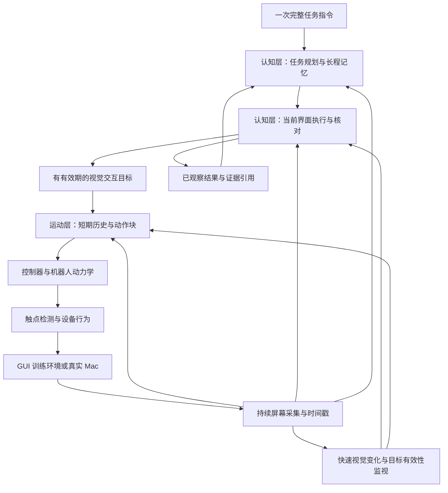

> Public export, 2026-10-30. Host/account identifiers and private evidence paths are removed. This is a design snapshot; current implementation and experiment status are maintained in STATUS.md and experiments/ledger.jsonl.

> 2026-10-31 最新选型：[ADR 0006](decisions/0006-latest-leap-and-hardware-readiness.zh-CN.md)采用 LEAP v2 Advanced 完整高配目标，取代先前 v1 选择；17 电机与 21 运动关节分开建模，金属硬件参数未校准。当前先验收固定掌部的完整手，再组合机械臂；动作宽度按实际执行器映射确定。下文明确标注的 Allegro 23 维例子仅为历史协议示例。

**机器人触控板项目：后端架构修订 v2**

2026-10-30，Asia/Hong_Kong。本文是根据最新讨论提出的设计基线，尚无本项目训练、Mac 输入桥接或机器人动作实验结果。它取代 v1 关于固定指距二指主线、Qwen2.5 默认模型、单步低层默认策略及统一 BC→PPO 路线的建议。资源数目沿用同日只读审计，不代表已分配 GPU；本轮新增的是论文、官方文档和模型卡核验。

**1. 当前建议与取舍**

| 问题 | v2 建议 | 理由与边界 |
|---|---|---|
| 主机构 | LEAP v2 Advanced 完整五指手，全部 17 电机通道开放；后续组合固定基座机械臂 | 21 个运动关节含 4 对 PIP/DIP 耦合，掌部 2 个主动关节；先验证固定掌部动力学，再验证安装、触控板工作空间及接触 |
| 简化对照 | 两根有独立关节、可改变相对位置的手指 | 保留简单硬件方向；在主要接口和任务跑通后对比，不再以固定指距机构限定主任务 |
| 机构对照 | 已有 Allegro 结果作为独立回归参考；暂不增加 Shadow 主线 | 研究重心为视觉反馈、动作块、记忆与纠错；旧模型结果不能归入 LEAP 的验收 |
| 主物理训练 | MuJoCo CPU 做正确性参考，MuJoCo Warp 在 H800 做批量仿真候选 | 先验收接触、执行器及吞吐；不把普通 CPU MuJoCo 当 CUDA 仿真 |
| 认知层 | 任务规划与记忆、当前界面执行两个逻辑角色 | 初期可复用同一个 VLM，用不同上下文与调用预算；后续可蒸馏快速执行器 |
| 上层主候选 | Qwen3.8-27B | 已核验官方开放权重、图像/视频能力、Apache-2.0；尚未测本任务定位和延迟 |
| 快速模型对照 | Qwen3.5-9B、Qwen3-VL-8B-Instruct | 对比 GUI 定位、结构化输出、记忆和端到端时间，不只比较模型年份 |
| 运动层 | 视觉特征 + 本体状态历史 + Transformer 动作块策略 | ACT 风格的短动作块、滚动重规划；CNN/GRU 单步策略保留为对照 |
| 运动学习主线 | BC → DAgger/纠错；按失败原因决定是否增加 RL | ACT 与时间集成不直接套用单步高斯 PPO 的概率比公式 |
| 长程记忆 | 短期视觉历史 + 带证据的语义记忆 + 可检索事件档案 | 借鉴 MEM；保存时间长不等于已经学会正确使用记忆 |
| 观测与通信 | 图像走原生视觉输入，运动状态走连续张量；跨层用版本化结构化消息 | 规范语义、单位、时钟、坐标、有效期，而非把所有数值字符串化 |

主课程优先覆盖单/双指交互，但完整手的执行器始终可用。拇指/食指禁用实验仍属于整体训练与主要评估后的可选测试。人形平台的身体平衡与触控板交互暂时分离；先研究手臂和手的闭环操作。

**2. MuJoCo 在 H800 上怎样工作**

MuJoCo 的物理计算、场景渲染、神经网络推理/训练是三条不同的计算路径。

| 路径 | 物理计算位置 | 适用情况 |
|---|---|---|
| 常规 `mujoco` / `mj_step` | CPU | 单环境交互、调试、接触参考；同机 PyTorch 可以同时使用 H800，但这不改变物理步进位置 |
| MJX-JAX | JAX GPU/TPU | 大批量同构环境；小批量不保证比 CPU 快，模型特性需与后端匹配 |
| MuJoCo Warp / MJWarp | NVIDIA GPU | 接触与约束较多的并行机器人仿真；可直接使用 Warp，也可经 MJX 的 Warp 后端 |

官方文档确认这些加速路径；H800 的 CUDA 计算能力适合这一方向。Isaac Sim 对 RTX/RT Core 的要求，不能外推为 H800 无法做 MuJoCo 物理仿真。反过来，物理计算可运行，也不能证明所有渲染后端或插件兼容。当前查询到的服务器 MuJoCo 3.8.0 包元数据不证明 MJWarp 已安装或已运行。

建议先建立可重放的 CPU 参考场景，再在实际 Slurm 分配的单 H800 上运行相同场景。批量从 1、32、128、512 逐级增加，分别记录编译/预热、稳态物理吞吐、策略推理、GUI 渲染、完整交互吞吐及显存。检查位置/速度、接触事件、约束误差与最终 GUI 结果；数值容差根据任务尺度制定，不要求两种求解器逐位一致。固定接触和约束缓冲区须覆盖最坏场景并检测溢出，不能静默丢失接触。

主线优先选择 MJWarp 直接接口与 PyTorch 训练栈，减少 JAX/PyTorch 并用的工程负担；是否使用现有 manager 框架由小场景验收决定。CPU 与 GPU 间逐步复制图像或大量张量可能抵消加速，应批处理，检查共享设备缓冲区的所有权和同步点。

**GPU 仿真快，并不让一台真实 Mac 变成数千个独立桌面。** 大量并行采样来自可重置的 GUI 训练环境；真实 Mac 在环主要负责校准、适配、纠错与正式评估。必须同时报告纯物理 steps/s、包含 GUI 的 transitions/s 和真实 Mac 的任务吞吐，避免只展示物理引擎数字。

**3. 完整灵巧手与两指方案**

已读取的 Menagerie 模型中，Allegro 是四指、16 个关节/执行器；Shadow 是五指、24 个关节、20 个执行器，含耦合。假设配 7 个独立位置控制通道的机械臂，Allegro 组合模型的初始动作维数是 23。最终以编译后的模型清单为准，不能用名称推断所有关节都能独立驱动。

主动作定义为**执行器位置参考** `u_ref[t:t+H]`，而不是直接写仿真关节位置。策略输出按执行器量程归一化，经限位、速度/加速度约束与控制器跟踪后进入动力学。Allegro 参考可以对应关节位置；迁移到有腱耦合的手时，须通过专属执行器映射。记录原始预测、最终执行参考和实际传感状态。

固定指距仍可完成很多移动、点击、拖动和双指滚动。捏合需要指间距离变化；旋转更关注触点连线角度变化，不能把所有双指行为都归因于指距。不过，固定指距会限制接触组合、指尖摆放与后续手势扩展，因此不再作为主模型约束。

先做几何和动力学检查：两指能否同时平放、指腹方向、工作空间、板边重定位、手掌是否误触、指间/手板碰撞、腕部可达性。现成 Allegro 模型存在不代表这些检查已通过。拇指是否有用由任务和学习结果决定，用户较少使用拇指是合理经验，但不等同于机器人拇指必然无价值。

训练早期使用单/双指任务与较简单初态，随后增加指间相对运动、腕姿变化和更长操作。可以用教师偏好的简单轨迹帮助起步，但不把其他手指硬锁死。简化二指机构需要自己的模型、控制范围和示范；从大手蒸馏时应转移目标、接触意图或重新生成动作，不能复制不同机构的关节标签。

**4. 分层的职责、粒度与持续视觉反馈**

两类可学习模型承担三个逻辑角色：

1. **任务规划与记忆**：维护整体指令、已核实进展、约束与尚待完成项。例如“检查这批候选图片，选出符合条件的三张并放入目标文件夹”。
2. **界面执行与结果核对**：根据当前屏幕，把当前任务阶段落实为合适的视觉交互目标，并核对界面变化。例如“打开这一张以便核对内容”“把已确认图片放入目标文件夹”。它与第一个角色可复用 VLM 权重，不必从第一天训练三个大模型。
3. **运动控制**：接收有视觉依据的目标，直接生成手臂/手指动作，使光标、接触和界面交互发生。动作轨迹由模型随反馈更新，不由上层写成逐毫米脚本。

仅把上层指令改得更粗，却仍让一个很小的 MLP 负责理解任意应用、多窗口和几十步语义流程，会造成能力缺口。因此要明确界面执行角色，而不是声称它自然包含在关节控制里。



频率均为起始设计预算，实际取决于测得的 p50/p95 延迟：

| 环节 | 起点 | 读取内容与用途 |
|---|---|---|
| 屏幕采集 | 目标 30 Hz | 单一时间戳图像流，供各角色取用；采集持续不代表每帧运行大模型 |
| 光标/局部目标跟踪、变化监视 | 20–30 Hz | 像素推断位置、可信度、遮挡/界面变化；不读取系统光标坐标真值 |
| 运动策略 | 20 Hz | 最新可用图像特征、短历史、本体状态、当前目标；每 50 ms 重规划 |
| 动力学/执行器跟踪 | 初始 240 Hz | 每个策略周期 12 个物理子步；接触刚性和误差需要时再调整 |
| 界面语义执行 | 事件触发，目标约 0.5–2 Hz 上限区间 | 新目标、执行后核对、弹窗、跟踪失效等；达不到预算则等待/停止当前交互 |
| 整体任务规划 | 阶段转换、失败升级、指令变化时触发 | 不在每次手指小幅移动时重写整个计划 |

运动层处理局部偏差：光标过冲、暂时没有触发点击、需要抬指重定位。认知层在语义问题出现时介入：弹窗、当前目标失效、短程反复失败、当前阶段完成、用户修改任务等。快速监视器可以暂停旧动作并请求重观察，但不能凭一个像素变化就确认任务成功。

**完成判定分成三种证据**：运动层报告“这个动作尝试结束/需要观察”；界面执行器根据新截图确认“预期窗口/选中/移动结果出现”；任务层确认原始要求全部满足。正式评估器可独立检查最终文件状态，但评分真值不回传策略。完成时间戳在按钮按下或函数返回时提前写入，会污染训练与任务记忆。

异步消息必须带观测版本和目标版本。旧截图上算出的目标若已经失效，不能在推理结束后继续执行。等待大模型时，按当前交互阶段选择保持、回撤或释放；不机械地在每个推理间隙释放拖动，也不无限保持按压。

**5. 借鉴 MEM：怎样保存并训练长程记忆**

已核对的论文是 **MEM: Multi-Scale Embodied Memory for Vision Language Action Models**（arXiv:2603.03596），而非 MAM。论文报告的任务跨度为最长约 15 分钟，并不是任意任务都能稳定超过 15 分钟。

MEM 的高层同时预测下一子任务与更新后的语言记忆；低层从短期观察序列预测连续动作块。训练语言记忆时，作者把已有子任务标注及成功/失败信息交给预训练 LLM，生成仍与后续任务有关的摘要作为监督。短期视频编码器在 ViT 中加入时空分离的注意力，在高层只保留当前时间步的视觉 token，利用这些 token 携带近期信息。文中实现每四层增加因果时间注意力，不增加新的可学习参数；预训练用 6 个观察、间隔 1 秒，后训练实验扩展到最多 18 帧/54 秒。它还依赖大规模机器人、纠错、图文和视频数据，不能把这些效果归因于单独增加一个缓存。

本项目先借鉴其**多时间尺度记忆和记忆更新监督**，不声称已经复现 π0.6-MEM，也不直接修改新 Qwen 的视觉编码器后假定原能力保持。

| 记忆 | 初始设计 | 作用 |
|---|---|---|
| 运动工作记忆 | 最近 16 个策略时刻，约 0.8 秒；缓存视觉特征、本体状态、过去动作及帧龄 | 区分正在按压、拖动、释放，估计光标响应与短时偏差 |
| 认知短期视觉记忆 | 最近约 5–10 秒的少量时间标记帧；关键事件保留更密片段 | 判断刚才发生什么、哪个尝试失败、窗口怎样改变 |
| 长期语义记忆 | 已核实事项、待办项、失败尝试、约束、计数、必要的精确文本 | 跨窗口、跨阶段维护任务状态 |
| 事件与证据档案 | 按对象/事件/时间存截图裁剪、结果、来源帧与修订关系 | 检索旧图片、纠正错误摘要、审查依据；原始记录不被摘要覆盖 |

长期记忆应区分 `planned`、`attempted`、`observed_success`、`uncertain`。例如“尝试复制第 3 张图片”不能被压缩成“已复制 3 张”。精确文件名、数值和目标条件需要保留原文或证据截图；用“几张图片”概括它们会丢失后续操作需要的信息。检索键包括当前子目标、对象视觉描述及最近失败；每次仅取少量相关证据，避免把完整 15 分钟视频反复送入模型。

训练样本是 `(当前/近期观察, 原任务, 旧记忆) → (下一目标, 记忆增量, 证据引用, 状态)`。训练标签只使用该时刻以前可得的信息；离线教师知道评估真值时，也必须给记忆中的成功事实配上策略可观察的证据。先用教师生成并检查的记忆训练，再采集模型自己的摘要与失败恢复样本，修正推理时累积的遗漏和误记。仅在正确摘要上做 teacher forcing 不足以证明长期运行可靠。

记忆测试应设置过去信息已经离开屏幕、当前画面相同但历史不同所以应选不同动作的任务。比较无记忆、文本记忆、视觉记忆、混合记忆；观察重复处理、遗漏、错误计数、恢复后的状态一致性。3/10/15/20 分钟是逐级评估范围，不以等待或放慢动作凑时长，也不把运行 15 分钟本身当成记忆证据。

**6. 数据怎样产生：真实 Mac 与仿真各自负责什么**

真实 Mac 视觉对最终应用适配很重要，但单独的视频没有本项目的关节动作标签，也不告诉我们“换一种动作会发生什么”。视频中的相同光标轨迹可以对应多种手指、腕部和接触轨迹，无法唯一反推出机器人控制。

| 数据层 | 内容与生成方法 | 可以训练什么 |
|---|---|---|
| 真实 Mac 图像/视频 | 合法采集屏幕；有条件时同步记录人类鼠标/触摸输入、任务与结果 | GUI 识别、定位、步骤、结果核对、任务记忆；不是机器人关节真值 |
| 公开 GUI 定位数据 | 如已核验的 OS-Atlas desktop 子集 | 图像到目标框/文本；不提供本机器人动作，也不提供完整长程记忆监督 |
| 可重置 GUI + 仿真机器人 | 教师产生手指轨迹，经 IK、执行器与接触动力学实际运行，触点驱动 GUI | 运动 BC、接触/重定位、DAgger、受控 RL、系统性扰动采样 |
| 机器人仿真 + 真实 Mac | 人类遥操作仿真手，或已训练策略通过同一触控板桥接操作真实应用；同步记录全过程 | 与最终系统最接近的动作—视觉配对、纠错、上层决策和长程适配 |

一个点击教师示范的生成过程：

1. 在可重置 GUI 中采样目标与光标初态；教师可读训练真值，学生只能看图像。
2. 教师根据屏幕误差和当前设备增益估计所需板面位移。增益非线性、运动范围有限时，使用反馈控制与抬指重定位，不能只做一次线性映射。
3. 选择可达的手指配置，求关节参考并做时间参数化，由 PD/执行器在 MuJoCo 中实际运动。
4. 虚拟触控板根据触点时序产生相对移动和按压/释放等事件，GUI 真正更新。
5. 保存实际动作、状态、图像、触点、事件、目标和结果。保存失败与纠正；把“轨迹被求解出来”与“操作成功”分开。

教师允许有更多训练信息，部署策略必须使用部署可得观测。真实 Mac 任意应用不存在可假定完美的教师；该部分优先由人遥操作仿真手和人工纠错提供示范。人类直接操作触控板的日志可以提供轨迹目标，但仍须经机器人重定向、动力学执行与结果检查才能成为关节示范。

静态 Mac 截图可做定位和感知增强；把录像按时间播放给策略不能构成交互环境，因为策略行为无法改变后续画面。真实 Mac 在环采用实际时间；纯仿真的点击阈值、双击间隔等使用仿真时钟。并行训练 GUI 不被称为完整 macOS 仿真，最终真实 Mac 成绩单列。

数据按整段轨迹、任务、布局/文件集合分组切分。记录策略/教师版本、设备增益与桥接版本、截图捕获时间与接收时间、实际执行动作、原始预测、阶段边界和纠错来源。数值及索引用 Parquet/张量块保存，原始观察保存可复原图像；压缩视频用于回看，不能用有损回看文件替换训练实际输入而不声明差异。

**7. 动作块、时间集成与运动网络**

主候选采用 ACT 风格的 Transformer 动作块策略。初始设置：策略 20 Hz、每次预测 H=8 个位置参考，即约 0.4 秒；通常执行 1 步后用新观测再次预测。可对比每 2 步重规划，但应明确最大反馈间隔变为 100 ms。动作块表达短期协调，滚动重规划保留闭环。

对于同一个实际执行时刻 t，多个历史预测都可能给出一个参考 `u[t|s]`。只在目标、身体形态、交互阶段和手指策略一致且预测仍有效时计算加权平均：

`u_t = sum_s(w(t-s) * u[t|s]) / sum_s(w(t-s))`

这是同一时刻的重叠预测融合，不是把动作块内部未来几个时刻平均。新观测更相关时可采用偏重新预测的权重，但需要和不集成/原 ACT 风格权重比较。已检查的 ACT 原仓库按旧预测到新预测排列后使用 `exp(-k*arange(n))`，不能把“总是更重视最新预测”归为原算法结论。

平滑并不保证点击可靠。落指与抬指、拖动与释放、不同手指方案之间平均，可能产生不够深的点击、延迟释放或没有意义的姿态。新窗口、目标切换、误触、接触阶段变化时应取消不兼容旧块；速度/加速度约束负责基本可执行性。使用显式有效 mask，不能沿用“动作所有维度非零才有效”的判据，因为零参考可能合法。

图像编码可先用共享 CNN/ViT 编码全屏缩略图与原分辨率局部裁剪，数值历史投影为连续 embedding，加入时间位置编码和当前视觉目标后由 Transformer 输出 `[H,D]`。初版可用 ResNet-18 + 4–6 层、宽度 256–512 的小 Transformer 作为预算起点；参数量和输入裁剪须在延迟与任务质量之间实测。若采用 ACT CVAE，则训练动作重建和 KL 项，推理潜变量设定、KL 系数和归一化均进入配置。它不是把 ACT 的原始单帧观测代码不加修改直接装上本项目。

| 网络 | 适合的能力 | 主要限制/比较意义 |
|---|---|---|
| 图像编码 + 单帧 MLP | 已定位目标的低延迟控制；可作为可解释基线 | 单帧难分辨相同画面下的按压历史、惯性滚动和不同失败尝试 |
| MLP + 帧堆叠 | 简单有限历史 | 窗口长度固定；维数增长快，但仍值得做小基线 |
| CNN + GRU | 在线短记忆，低开销；容易搭配单步 recurrent PPO | 长语义记忆不可仅依靠隐藏状态；复杂多模态轨迹未必合适 |
| Transformer / ACT 风格 | 联合预测多关节、多个时刻，处理条件和短历史 | 训练数据、推理预算、时序与阶段处理要求更高 |
| Diffusion/flow 动作模型 | 多种有效手指配置与轨迹的多模态分布 | 推理步数与延迟；后续必要时再加入，避免首版变量过多 |

MLP 也可以一次输出 H×D 个数，因此“MLP 还是 Transformer”“有没有历史”“单步还是动作块”是三个独立实验因素。比较网络时固定传感输入、训练集、执行频率和控制器，再分别比较预测跨度与时间集成。

训练默认 BC→DAgger/纠错。对普通单步随机策略，recurrent PPO 是独立合理基线。对 ACT，时间集成后的执行动作不是普通单步高斯采样动作，不能把它套进错误的 PPO log-prob。若 BC/DAgger 后仍需 RL，先定位失败：机械接触可考虑冻结 ACT 后加有界 residual actor，并记录上下文、约束前的采样及实际执行动作；或单独研究正确建模整块概率的 chunk RL。此时应单列算法和实验，不继续沿用 v1 的统一 PPO 超参数。PI 的 RTC 对异步动作块衔接也可借鉴，但其 flow/diffusion 补全方法不是普通 ACT 时间平均的替代名称。

**8. 更新上层模型与 H800 训练资源**

本轮核验到：

| 模型 | 官方信息 | 在本项目的角色 |
|---|---|---|
| Qwen3.8-27B | 2026 年 8 月创建的官方权重库；原生图像/视频输入；Apache-2.0；本次 API 总参数约 27.78B | 上层主候选、离线数据教师与记忆更新训练 |
| Qwen3.5-9B | 官方视觉语言权重；Apache-2.0；本次 API 总参数约 9.65B | 更快界面执行器/蒸馏学生，对照部署延迟 |
| Qwen3-VL-8B-Instruct | 官方视觉语言模型；保留作较成熟的定位/格式基线 | 检查新模型收益和依赖兼容性 |

Qwen2.5-VL 不再是默认方案。选择 27B 也不是因为模型卡的通用榜单就能证明触控板任务更强；要测试小控件定位、中文 Mac 界面、结果核对、历史依赖、恢复和结构化输出，并记录延迟分位数。

27.78B 权重仅 BF16 约 55.6 GB。用约 16 bytes/参数估算混合精度 Adam 类全参数训练，参数/梯度/优化器状态约 444 GB，尚未计激活、视觉序列、通信缓冲与框架额外占用。8×H800 80 GB 可作为全量微调的现实资源档位，采用 FSDP 或 ZeRO-3、梯度检查点和受控序列长度后先做实际显存验收；这不是把 8 卡当一张 640 GB 的卡。4 卡在该基础估算下不够，若要用更少卡须另行引入优化器/卸载等方案。9.65B 对应基础状态约 154 GB，2 卡余量紧，4 卡更适合初步全量微调。

建议先获得冻结模型基线，然后在同一数据划分上比较 LoRA 与全量微调。数据量少时，全量更新不保证更好；H800 能提供计算，但不能补上未覆盖的操作、错误恢复和长程记忆监督。上层训练使用已验证的定位、下一目标、结果判断和记忆更新数据；不要求把整段 15 分钟视频塞进一次训练样本。

初始全量训练预算可从有效上下文 8k–16k、少量近期/检索图像、小 microbatch 和梯度累积开始，学习率约 1e-6–5e-6 为待调范围；视觉编码器是否解冻单列实验。LoRA 是成本/泛化对照，不作为“有 H800 也不能全量”的限制。完整冻结/LoRA/full 三者比较需要保持验证任务一致，避免把更新数据带来的收益算成算法收益。

H800 负责批量仿真、示范/评估、微调。全量微调占用一组 GPU 时，不默认还可以在同组卡运行大批量物理采样。真实 Mac 的快环部署在 RTX 工作站/可用本地近端 GPU：运动模型与快速视觉跟踪本地执行；27B BF16 若用 RTX 5880 48 GB，应规划多卡或已验证的量化方案，不能假定单卡完整装下。跨集群网络不进入每 50 ms 的运动控制硬依赖。

本次固定候选 revision：Qwen3.8-27B `1d4bf0f2ff6012fd82039f2fa52739d0dd7c60c0`；Qwen3.5-9B `c202236235762e1c871ad0ccb60c8ee5ba337b9a`；Qwen3-VL-8B-Instruct `0c351dd01ed87e9c1b53cbc748cba10e6187ff3b`。未下载权重、未完成运行时验收。

**9. 协议与 Token：先规范语义，再决定编码**

采用三层接口：图像使用模型原生 processor/视觉 token；任务、记忆和目标使用结构化文本；高频机器人状态/动作使用连续张量。初版不增加大量自定义 tokenizer token，也不将全部关节的高频状态编码成长串小数文本。以后若研究 FAST/VQ 动作 token，作为独立编码实验，保留同一物理语义。

| 消息 | 关键字段 |
|---|---|
| `EpisodeConfig` | `schema_version, episode_id, embodiment_id, actuator_order, joint_order, action_representation, units, calibration_id, bridge_version, cursor_profile` |
| `FramePacket` | `frame_id, stream_id, capture_clock_id, capture_time_ns, receive_clock_id, receive_time_ns, age_estimate_ms, age_uncertainty_ms, image_shape_px, image_ref` |
| `TaskContext` | 原任务、当前阶段、已核实事项、约束、待办、记忆版本、证据引用 |
| `SemanticGoal` | `goal_id, parent_goal_id, observation_id, desired_visible_state, completion_evidence, valid_until, memory_refs` |
| `MotorIntent` | `intent_id, goal_version, observation_id, interaction_kind, target_bbox_norm, destination_bbox_norm, target_confidence, calibration_id, expiry` |
| `MotorObservation` | `q, qdot, previous_executed_action, visual_features/history, cursor_estimate, confidence, frame_age, intent_embedding, validity_masks` |
| `ActionChunk` | `policy_version, embodiment_id, goal_version, observation_id, command_type, start_time, dt, horizon, values, valid_mask, phase_estimate` |
| `AttemptOutcome` | `intent_id, motion_status, visible_outcome, evidence_frame_ids, uncertainty, request_replan` |
| `MemoryDelta` | 新事实/修订/待核实项、来源事件、证据引用、被替代条目、生成观测时间 |

屏幕目标框采用捕获图像坐标系、左上原点、`[x0,y0,x1,y1]∈[0,1]`；对应像素、macOS 逻辑点、全局桌面坐标的变换由 calibration 定义。物理位置用米、转动关节用弧度、时间用秒或带明确时钟域的整数纳秒。不同机器的单调时钟不能直接相减，帧龄估计需要同步/映射与不确定度。动作按 `actuator_order` 排列，不用 joint_order 替代执行器清单。

认知层输出示例（虚构编号与坐标，仅说明格式）：

```json
{
  "schema_version": "trackpad.v2-draft",
  "episode_id": "ep_demo_001",
  "observation_id": "frame_842",
  "memory_version": 12,
  "goal_id": "inspect_candidate_3",
  "desired_visible_state": "预览窗口显示第三张候选图片，可检查其中的物体",
  "motor_intent": {
    "intent_id": "intent_87",
    "interaction_kind": "activate",
    "target_bbox_norm": [0.42, 0.31, 0.49, 0.40],
    "target_confidence": 0.92,
    "calibration_id": "single_display_v1",
    "expires_after_observation_ms": 1200
  },
  "completion_evidence": "新截图中可见对应图片的预览内容",
  "memory_delta": {
    "attempted": ["准备打开第三张候选图片"],
    "observed_success": [],
    "evidence_frame_ids": ["frame_842"]
  }
}
```

运动层不消费该 JSON 的逐字 tokenizer 表示。数据适配器把已验证目标变成 embedding/数值字段，与本体状态及图像特征组成张量。历史 Allegro + 7 轴实例的动作形状是 `[B,8,23]`，`dt=0.05 s`；这 23 维位置参考会驱动机器人，不能解释为 23 个软件点击命令。动作有效期与 GUI 目标有效期分开管理；高速循环只执行对应当前时间与当前目标的动作片段。

解析失败、未知 embodiment/单位、坐标或动作越界、时间戳过旧、goal_version 不匹配时，不执行消息。收到新图像不自动意味着旧目标失效；目标有效性由局部跟踪、场景变化和版本规则共同判断，避免每帧刷新都打断正常拖动。

训练真值放入单独的 `teacher/critic/evaluator` 存储与进程接口。运行 actor 的 batch 构造器采用字段白名单；不能因为同一数据文件中有真值就无意拼进网络。图像推断的 cursor/target 与 oracle 坐标使用不同字段名与来源标识。

**10. 训练课程与验收顺序**

1. **设备与物理参考**：接触、轻触/按压、抬起、相对移动、滚动、可变指距；检查触点身份与事件溯源。CPU 正确性与 H800 吞吐分别验收。
2. **短闭环**：随机目标、点击、拖动、重定位、双指滚动/捏合的训练环境；先做数百条教师轨迹检查数据，再扩到数千条试训练。轨迹数是数据管线起点，不是足够训练完整手的保证。
3. **BC 与 DAgger**：ACT 风格主候选和 GRU 基线采用相同训练/测试划分；学生访问状态上的纠错进入下一轮训练。针对误触、接触阶段、增益和延迟分类分析。
4. **真实 Mac 适配**：同步采集仿真手动作与真实界面反馈，处理时延、光标、真实窗口与滚动差异。真实应用缺少教师时由人遥操作仿真手提供纠错。
5. **认知与记忆**：训练定位、执行结果、记忆更新与恢复；先完成几分钟任务，再逐级测试 10–20 分钟任务与明确的延迟记忆依赖。
6. **算法/机构比较**：冻结任务与初态，对比单步/动作块、时间集成/无集成、记忆消融、完整手/独立可变指距二指；有明确机械控制瓶颈时再加入 RL。

采用放大的光标作为正式实验配置是合理的。记录光标大小、样式、显示分辨率和缩放，避免过大光标挡住目标；另设正常尺寸/不同尺寸作为泛化条件即可。此处不要求策略在首版就克服难以观测的小光标。

机械能力与 Mac 桥接能力分别验收。普通鼠标/滚动 CGEvent 路径不等于 Apple 原生多点触控、缩放、旋转或 Force Touch。可在可重置 GUI 中先训练指间距离控制与缩放响应；真实 Mac 的原生捏合通路仍须单独验证。不能用上层直接调用放大按钮或快捷键来冒充机器人捏合已经成功。

主要指标：端到端任务成功率、任务时间、误操作、恢复率、人工介入、记忆遗漏/误记、动作延迟、接触异常及训练资源。动作平滑性只是辅助指标；应同时看点击/释放时机与任务结果。展示完整评估清单和失败运行，教师或人工纠正轨迹与自主测试分别统计。

**11. 本轮核验的主要来源**

- [MuJoCo MJX 官方文档](https://mujoco.readthedocs.io/en/stable/mjx.html)；[MuJoCo Warp 官方文档](https://mujoco.readthedocs.io/en/stable/mjwarp/index.html)；[MJWarp 仓库](https://github.com/google-deepmind/mujoco_warp)。
- [MEM 论文全文](https://arxiv.org/html/2603.03596v2)；[PI 的记忆研究说明](https://www.pi.website/research/memory)。
- [ACT 论文](https://arxiv.org/abs/2304.13705)；[时间集成实现](https://github.com/tonyzhaozh/act/blob/main/imitate_episodes.py)；[PI Real-Time Action Chunking](https://www.pi.website/research/real_time_chunking)。
- [Qwen3.8-27B](https://huggingface.co/Qwen/Qwen3.8-27B)；[Qwen3.5-9B](https://huggingface.co/Qwen/Qwen3.5-9B)；[Qwen3-VL-8B-Instruct](https://huggingface.co/Qwen/Qwen3-VL-8B-Instruct)。
- [MuJoCo Menagerie](https://github.com/google-deepmind/mujoco_menagerie)；手模型 XML 和既有 OS-Atlas、DAgger、PPO 资料见 公开参考资料清单（见 docs/references.md）。

原始抓取、模型 revision 和失败请求记录保存于 私有来源核验目录；公开来源链接见 docs/references.md。PI 旧域名转向 `www.pi.website`；失败的旧路径未被当作内容不存在。本文所列速度、频率、动作块长度、模型规模与训练预算是可测的设计起点，均不代表已实现性能。
