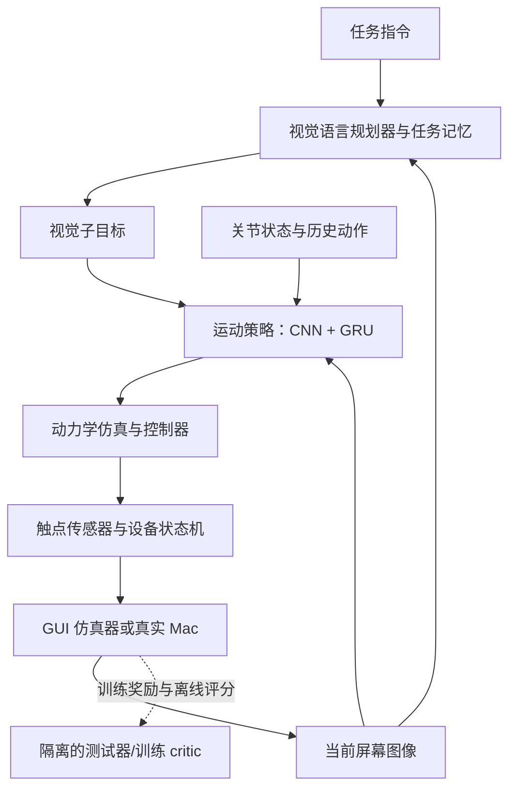
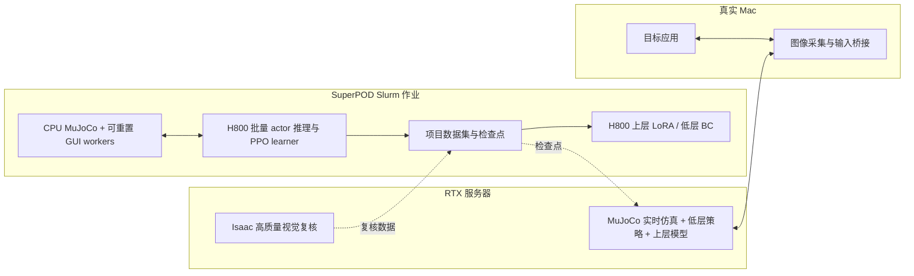

> Public export, 2026-10-30. Host/account identifiers and private evidence paths are removed. This is a design snapshot; current implementation and experiment status are maintained in STATUS.md and experiments/ledger.jsonl.

**机器人触控板项目：后端架构、训练方法与数据设计 v1**

> 历史设计，已由同目录《docs/architecture.zh-CN.md》更新。固定指距二指主线、Qwen2.5 默认模型、单步低层默认及统一 BC→PPO 路线不再作为当前实现依据；本文保留用于追溯。本轮仍为设计工作，没有训练结果。

2026-10-30，Asia/Hong_Kong。本文为拟采用的实现设计，尚未启动训练或生成本项目机器人数据。具体参数均为首轮实验起点，不是性能保证。二指是主线，完整五指是正式第二版；禁用特定手指只在主训练与评估完成后作为可选测试。

**设计选择一览**

| 项目 | 默认选择 | 原因与待验证项 |
|---|---|---|
| 主物理环境 | MuJoCo；先以 CPU 后端做正确性基线 | H800 节点可在本机采样，交互部署也用同一物理后端；已知服务器包版本 3.8.0，集群安装/运行待验收 |
| 并行物理扩展 | 吞吐不足时验证 MuJoCo Warp / MJX | 与 CPU 后端对比接触轨迹与任务结果后再启用；不默认数千环境一定更快 |
| 高质量视觉复核 | RTX 服务器上的 Isaac Sim 6.0.1 | 提供独立视觉/接触复核，非训练主循环的强制依赖 |
| 上层规划器 | Qwen2.5-VL-7B-Instruct | 可下载权重、多图输入、视觉定位、结构化输出；先冻结评估，再 LoRA 适配 |
| 下层运动策略 | ResNet-18 图像编码 + 数值编码 + GRU + 有界连续动作分布 | 直接支持逐步视觉反馈、历史记忆、行为克隆与 PPO |
| 低层训练顺序 | BC → DAgger → recurrent PPO | 分别解决起步、分布偏移和性能优化 |
| 上层训练顺序 | 冻结模型基线 → 定位/任务决策 LoRA SFT → 经验证的恢复数据迭代 | 首版不从随机权重训练大模型，也不依赖长程稀疏奖励的大规模语言模型 RL |
| 二指机构 | 共享 XY 移动 + 两指独立 Z 运动，4 个连续控制通道 | 对应可落地的简单结构；先固定指距，捏合需要另加相应自由度 |
| 五指机构 | 固定基座机械臂 + Shadow Hand E3M5 | 五指完整开放；公开模型为 24 个关节、20 个执行器，含耦合关系 |
| 数据主源 | 自建可重置 GUI、经过动力学的教师示范、策略纠错、真实 Mac 适配数据 | 现有 GUI 数据不包含本项目机器人关节动作 |
| 外部数据 | OS-Atlas desktop 的合适训练子集 | 只补截图目标定位；不作为机器人动作标签或完整长程轨迹 |
| 评估隔离 | 独立测试器，运行策略只能看到规定的视觉/本体观测 | 测试器可验最终文件，不能向策略传答案 |

**1. 到底在训练什么**

整个系统分成四类模块。视觉语言模型负责“当前任务下一步要达到什么状态”；运动模型负责“手现在该怎样动”；触控板与操作系统适配负责把接触变成输入；独立测试器负责判断结果。前两类需要学习，后两类是明确、可校验的系统实现。



上层可以输出“使此图标进入打开状态”，包括由图像推断的目标区域。它不能直接调用 Mac 的坐标点击。下层只能输出机器人运动。触点状态机可以像真实输入设备一样识别轻触/按压/滚动，但不能替机器人生成成功的运动轨迹。

两层记忆也不同：GRU 记住近期运动、光标响应和接触时序；任务记忆维护已经核对过哪些图片、当前准备复制哪一个对象、哪次操作还没有视觉证据。短期控制状态不能替代长程任务记忆。

**2. 二指动作空间怎样定义**

主机构先使用 4 个实际可控自由度：共享滑台 x/y，以及两根指尖的独立 z1/z2。每个策略步输出四个归一化数：

`a_t = [a_x, a_y, a_z1, a_z2] ∈ [-1,1]^4`

控制器把它们乘以对应速度上限，积分成位置参考，再由执行器/PD 控制器跟踪。每个位置参考仍需经过真实仿真动力学，不能把指尖直接移到期望位置。软件限制执行器行程、速度、接触力与台面穿透。

若采用机械臂承载这套末端，x/y 先转换为末端在板面坐标系中的目标增量，再通过逆运动学和关节跟踪控制执行；两根指尖仍有独立抬落机构。初版固定腕部姿态，这对应一个明确的机构/任务范围。以后增加腕部转动或可变指距时，要更新动作维度和示范，不能假设原模型自动会用新增自由度。

它应自行学习单指滑动、另一指悬空；双指共同滑动；抬指后重新落到板面中间；维持按压进行拖动；到目标附近减速等行为。自主性体现在这些动作由当前观测决定，且错误后会改变轨迹。

**3. 五指版的动作不是“把 4 改成 5”**

本轮直接解析了 MuJoCo Menagerie 的 Shadow Hand 右手 XML：24 个关节、20 个执行器，包括手腕和部分手指的腱耦合。不能给 24 个关节分别发独立目标来假装符合原硬件。

若配 7 通道机械臂，设计起点是 7 + 20 = 27 个动作通道；固定基座且没有其它关节时，关节位置状态约 7 + 24 = 31 维。最终以组合模型编译后的关节/执行器清单为准。策略改变执行器控制参考，耦合关节按模型关系运动。

五指版共享视觉编码、子目标格式、触点/GUI 协议和任务集，重新建立本体状态编码器、动作输出头和教师控制器，并完成自身 BC/DAgger/PPO。它不直接使用二指的动作标签或低层检查点。五指均正常开放，不在主训练中禁用拇指或食指。

Allegro 和 LEAP 的这里所查模型都是四指，不能替代正式五指版。Shadow 模型具备五指，不代表其所有 Mac 原生手势已实现；机器人机械能力与设备桥接能力分别验收。

**4. 物理时钟、视觉时钟与动作时钟**

首轮固定以下起点，吞吐与稳定性测试后再调：

| 环节 | 设计起点 | 含义 |
|---|---|---|
| 物理步进/执行器控制 | 240 Hz | 每个物理步约 4.17 ms |
| 运动策略更新 | 20 Hz | 每 50 ms 重新观察并决定动作，每个策略步包含 12 个物理子步 |
| Mac 屏幕采集 | 目标 30 Hz | 策略取最近已到达帧，必须保留真实时间与帧龄 |
| 上层任务规划 | 子目标结束/失败/界面变化时触发 | 不保证固定每秒多少次，也不能让它负责 240 Hz 控制 |

低层先逐步输出动作，不一口气执行几秒钟的动作块。滑动过程中每 50 ms 可重新修正；即使上层正在思考，下层也有明确的保持或结束接触行为。图像过期、用户接管或桥接断流会触发设备层释放/停止，不能继续使用很久以前的目标。

Mac 在环按实际时间运行。纯仿真可以快于实际时间，但触控板点击时限、双击间隔等必须使用仿真时钟，不能因加速采样而改变手势定义。跨机器的时间戳不能直接相减当精确延迟，需要校时或同机往返测量。

**5. 策略能看到什么，不能看到什么**

首个运动模型使用屏幕视觉、本体状态、上层视觉子目标和历史动作。手部相机首先用于观察/记录，之后可作为明确的新观测分支加入；不能把未使用手部相机的结果称为完全依靠外部摄像头操纵。对固定板面、已标定机构，本体状态足以先研究手指接触控制。

| 信号 | 运行时来源 | 是否进入运动 actor |
|---|---|---|
| 当前屏幕图像/局部裁剪 | GUI 渲染或 Mac 屏幕采集 | 是 |
| 光标位置与置信度 | 图像检测器/跟踪器 | 是；不能换成系统直接查询的光标真值 |
| 目标框与目标有效性 | 上层截图定位与视觉跟踪 | 是；目标失效需重新观察 |
| 关节位置、速度 | 可对应真实编码器的仿真传感读数 | 是，可加延迟/噪声 |
| 上一次请求的动作 | 策略自身记录 | 是 |
| 指尖真实接触、GUI 内部状态、精确目标坐标 | 仿真器内部 | 设备模型/训练教师/critic/测试器可用，actor 默认不用 |
| DOM、辅助功能树、文件列表、剪贴板内容 | 系统内部接口 | 不进入运行策略 |
| 每步奖励、成功真值 | 训练测试器 | 不作为运行 actor 的观测输入 |

在定位监督阶段可以使用人工或数据集框作为标签，在教师数据中也可以存在正确目标。端到端评估时必须改为从图像预测，并在训练中纳入预测误差。否则测到的是“已知目标位置如何移动”，不能当作整个视觉电脑操作系统。

第一阶段直接用截图；后续真实摄像头/仿真显示器纹理模式加入透视、模糊、遮挡与光照。两种模式的成绩分开列。

光标感知先以多模板、尺度搜索及时间跟踪作为可解释基线；模板来自合法采集的可见光标样式。用自建画面合成光标位置标签后，可训练小型热图检测器，必要时用少量人工标注的真实截图适配。模板匹配/检测器看到的只有像素，不读取 OS 光标坐标。目标由 VLM 初次定位，再用图像匹配或光流跟踪；窗口明显变化、目标遮挡或置信下降时重新定位，不让旧框无限沿用。

**6. 模型具体长什么样**

上层默认 `Qwen/Qwen2.5-VL-7B-Instruct`。本轮核验模型卡为 Apache-2.0、支持图像定位及结构化输出；记录到的 revision 为 `cc594898137f460bfe9f0759e9844b3ce807cfb5`。部署应固定实际下载 revision，而不长期追随 main。它是可复现的初始选择，尚未证明最适合本项目。

上层输入：原始任务、当前截图、必要时上一张关键截图、短任务记忆、上一个子目标及可见结果。输出受 JSON Schema 约束的目标对象，例如：

```json
{
  "intent": "activate",
  "target_description": "当前 Finder 窗口中的目标图片",
  "target_bbox_norm": [0.42, 0.31, 0.49, 0.40],
  "destination_bbox_norm": null,
  "expected_visual_change": "预览窗口显示该图片",
  "status": "in_progress"
}
```

这里的坐标仅为格式示例。目标坐标在截图中归一化到 0–1，再由控制侧保留的显示变换映射回相应图像坐标。它不直接成为 Mac 输入事件。

`intent` 初始包含移动到目标、激活目标、上下文操作、拖动到区域、滚动、等待这六类交互意图。它们约束目标含义，不提供固定手指轨迹。上层选择不同意图和目标，低层通过连续动作实现。

低层默认结构：

1. 全屏缩略图（例如 448×256）保留布局。
2. 目标区域与光标附近各取 128×128 的原图裁剪，避免缩图抹掉小目标/光标。裁剪位置来自视觉预测。没有可靠预测时使用无效标记，不能用真值补上。
3. 使用共享 ResNet-18 编码器，各分支投影为 128 维，得到约 384 维图像特征。初期可复用 ImageNet 预训练卷积，BatchNorm 固定；调整图像编码器时通过单独的 BC 阶段评估。
4. 数值特征经两层 MLP 编码。参考格式包含 q、qdot、上次动作、视觉光标 xy/置信度/帧龄，以及子目标向量。
5. 拼接后输入 256 隐藏维的 GRU。
6. 两层 MLP 输出动作分布的均值与受限标准差。经 tanh 得到有界动作；部署评估使用确定性动作，训练探索使用采样。

一个可固定的子目标向量为：6 维 intent + 4 维目标框 + 4 维目的框 + 2 维操作参数（如滚动方向/目标位移）+ 2 维目标有效性/置信信号，共 18 维。数值输入总维度为 `2*nq + na + 4 + 18`，二指 nq=4、na=4 时为 34。五指按组合模型的 nq/na 生成配置，不能手写猜测。

GRU 用于估计当前输入增益、滑动/抬指历史以及近期执行误差。其隐藏状态在真实 episode 重置时清空，不能每个子目标都无条件清空。训练序列需要保存起点状态或用 burn-in 重建，不能把相邻控制帧随机打散。

PPO 使用独立 critic。critic 可读取真实接触、目标位置、GUI 状态等训练特权信息以改善价值估计，但其特征不能拼入 actor，也不随部署 actor 导出。这就是非对称 actor–critic 的具体边界。

**7. 环境怎样从仿真接到真实 Mac**

采用统一接口 `reset(task_seed)` 与 `step(robot_action)`。step 必须先推进机器人动力学，再从接触推导输入，最后让 GUI 状态响应输入并返回图像。任何 GUI 点击测试接口只允许用于环境单测/教师验证，不进入正式 robot_action 路径。

环境有三个难度层：

- 快速 GUI 任务环境：自己实现按钮、列表、滚动、图标选择、拖放、菜单和文件工作区，支持确定性重置与结果评分。图像由 CPU 绘制，不需要 RTX；接触仍由 MuJoCo 计算。它是训练环境，不是已复刻 macOS。
- 接近真实应用的训练环境：离线浏览器工作台或隔离桌面应用，保留真实事件时序、布局和窗口行为。逐步收集真实视觉与失败情况。
- Mac 在环：真实应用接受桥接输入，ScreenCaptureKit 返回图像。沿用同一运动模型和触控板协议；通过实际任务结果验收。

两个环境之间保持的是输入/观测契约，不能假定所有 GUI 行为和布局相同。训练界面的点击时限、双击、拖动与真实应用有偏差时，需要校准/适配。

虚拟触控板维护触点 identity、接触/抬起时序、点击保持、滚动状态。持续单指滑动产生相对位移 `delta_cursor = G(v, settings) * R * delta_pad`；抬指不移动光标，新触点不把光标瞬移到板面对应位置。G 是公开记录的可校准设备模型，不把 Core Graphics 的坐标事件称作真实 Apple 加速曲线。

触点检测是电容行为的近似替身，不是完整电磁仿真。模拟的接触力、几何接近与检测阈值要分开；手指悬空移动不能靠穿透或传感器错误取得奖励。点击/双击/拖动/双指滚动的规则需要先定、冻结并版本化，不能为迁就某个策略事后改成更容易。

设备状态至少区分无触点、单指待判定、单指滑动、按压保持/拖动、双指待判定、双指滚动。轻触结束是否产生点击取决于持续时间与移动量；双击次数根据真实触点历史生成；双指开始时重设相对参考，避免触点数量变化导致光标跳变。时间/距离阈值先在本地测试窗口标定再冻结，不在这里虚构 Apple 固件的精确常数。物理位置统一用米，触点协议若用毫米显式换算；屏幕像素、macOS 逻辑点与显示器全局坐标使用各自带版本的变换，Retina 倍率不能暗含在增益中。

**8. 数据具体从哪里来**

| 数据来源 | 有什么标签 | 用在哪里 | 目前状态 |
|---|---|---|---|
| Qwen 公开预训练权重 | 已有视觉/语言表征 | 上层初始化 | 模型卡已核验，尚未下载/运行本项目模型 |
| OS-Atlas desktop 训练数据 | 截图、指令、目标框；含 Windows/Linux/macOS | 上层/定位器监督 | 数据卡已核验，尚未导入本项目 |
| 自建随机 GUI 画面 | 可见目标、光标、布局、目标状态 | 定位预训练、基础任务 | 待生成 |
| 动力学教师示范 | 图像、本体状态、真实机器人动作、接触与 GUI 结果 | 低层 BC | 待生成 |
| 人操控仿真二指机构的示范 | 可对齐的机器人动作与图像 | 补教师难覆盖的策略 | 待采集 |
| 策略运行与 DAgger 纠错 | 学生到达的状态、教师纠正动作、失败类别 | 低层鲁棒性 | 待采集 |
| 策略真实 Mac 操作 | 图像、仿真机器人动作、触点、系统事件、结果 | 域适配与完整任务验证 | 待采集 |
| 人正常使用 Mac 的演示 | 任务、截图、输入事件、可见结果 | 上层决策/恢复监督 | 按实际需要采集；不能冒充机器人动作数据 |

OS-Atlas 数据卡声明 Apache-2.0；desktop 覆盖 Mac、Windows、Linux。其记录只有元素定位，并没有本项目需要的关节动作、触点轨迹或完整长程策略。部分标注由辅助功能树/HTML 提取：可作离线监督标签，训练和推理输入均只保留截图与任务指令，不让结构化页面树进入策略。

导入外部数据时保留具体子集、来源、许可、哈希和排除记录。ScreenSpot、OSWorld 等若作为对外报告的测试集，就不把其测试样本/任务答案加入训练；外部截图需要与保留测试集做近重复排查。本项目训练任务和最终 Mac 测试任务也按布局/内容/任务组合分组划分，不能随机按帧切分。

**9. 教师示范怎样生成，为什么不是“伪造机器人动作”**

教师可以知道训练目标的真实位置，然后用视觉伺服的理想信息版本求期望光标运动，结合触控板增益估计计算指尖滑动。到板边时规划抬指与重新落指，点击时规划相应接触时序。教师的动作同样交给 PD/执行器与 MuJoCo 动力学执行，不能直接改光标坐标。

记录的是实际发出的机器人动作、实际关节轨迹、接触与 GUI 响应。教师计划失败、错点或穿透时如实标记；成功样本用于基本 BC，失败样本供诊断和恢复训练。不能只因为几何目标可达就标为 GUI 操作成功。

人正常使用 Mac 的光标轨迹无法唯一反推出手指轨迹：手可能抬起、换指、加速，机器人还有自身关节限制。因此这一类数据只直接训练上层；若需要机器人标签，应在仿真中重新执行一次可行的机器人轨迹并验证。

初期教师可以采用一致的操作习惯，减少同一状态下截然不同动作造成的平均化。以后引入更多策略时，可通过意图/状态条件区分，必要时再验证混合分布或动作块模型，不直接给一个单峰回归器塞入冲突标签。

**10. 低层训练的三步**

第一步 BC（行为克隆）：用图像、状态与目标预测教师动作。参考损失为归一化动作上的 SmoothL1，加可选的接触阶段/光标定位辅助监督。接触标签可以作为训练输出目标，但不因此变成 actor 的运行输入。BC 阶段先训练动作头/GRU，再有控制地微调视觉编码。标准差先设稳定起点，不让监督拟合把探索能力压成零。

第二步 DAgger：让学生实际运行，收集它自己到达的偏移、滑错、抬指不充分等状态；在这些状态查询教师“接下来该怎么动”，把纠正样本加入训练，再训练学生。不要把初始成功教师轨迹重复播放当作 DAgger。训练教师失败的查询明确标记，不把错误指导当成答案。验证集不参与数据聚合。

第三步 recurrent PPO：在当前策略控制的并行仿真里采样，用任务结果优化动作策略。BC 提供起点，PPO 负责在不精确接触、增益和延迟等条件下提高成功率和效率。采用短序列更新与 GRU 状态管理，视觉编码器初期冻结，减少状态表征变化带来的不稳定。

PPO 目标使用标准 clipped policy ratio。设 `r_t = pi_new(a_t|o_t,h_t) / pi_old(a_t|o_t,h_t)`，优化 `min(r_t*A_t, clip(r_t,1-eps,1+eps)*A_t)`，加价值损失与熵正则。历史教师数据如果用于保持已有能力，应走单独的 BC 正则项，不能伪装为新策略的 on-policy 轨迹。

有界动作分布的 log-prob 必须包含 tanh 变换；保存策略采样动作、实际裁剪后的执行动作与旧策略 log-prob，不能把二者混淆。每批数据带 policy_version，更新期间不悄悄切换采样策略。

**11. 奖励如何避免“碰到了但没做成”**

奖励首先看 GUI 结果，再看效率与物理约束。可用的结构为：

`reward = once_per_goal_success + alpha*(gamma*Phi(next)-Phi(now)) - beta*time - eta*wrong_input - zeta*physical_violation - rho*action_change`

Phi 可表示距离当前目标的进展，用于基础定位任务。接近目标只提供学习信号；点击、拖动、滚动必须由独立 GUI 状态验证真正完成。成功奖励按目标 ID 只发一次，不能反复点击刷分。切换子目标/终止时正确处理势函数，避免悬停或循环动作获得无意义奖励。

物理惩罚包括过大接触力、越界、穿透和不必要的高频抖动。权重按归一化量纲和日志分布校准；不能让“少动”惩罚大到让静止成为最优策略。

真实失败结束与时间上限截断分别记录。时间上限截断一般需要价值 bootstrap，真正终止的 episode 则按终止语义处理。训练时可以用真值算奖励，但运行 actor 看不到奖励、目标真值或评分器内部信息。

**12. 上层怎样训练与维护长程任务**

先冻结 Qwen，检验截图理解、目标定位、动作前后比较与 JSON 格式。之后只对经过验证的训练样本做 LoRA SFT，主要适配：目标定位、子目标选择、任务状态更新和失败后恢复。

训练样本的输入是当前可见截图、任务和已有视觉证据支持的记忆；标签是下一个目标/意图及可见结果判断。教师可帮助生成候选决策，但必须执行验证或人工核对，不能把模型自己声称“完成”的文本当成成功标签。失败数据需要纠正后的目标或正确的“尚未完成”判断，不能把原错误决策原样当作正例。

初期 LoRA 只放在语言部分的注意力投影，视觉编码器冻结。参考起点：rank 32、alpha 64、dropout 0.05、BF16、学习率 1e-4、有效 batch 16、最多 2–3 个 epoch，按保留验证集早停。损失只计算需要生成的 assistant JSON token，提示词/图像占位等不作为预测标签。图像 token 与文本长度需要联合限额；不能盲目下采样到文字无法辨认。

任务记忆采用短 JSON 状态加只追加事件日志：原始任务、已确认完成项、当前子目标、尚未确认的输入、相关视觉证据 frame ID、失败与重试摘要。只保留关键画面给规划器，完整视频归档，不把十分钟每一帧都塞进上下文。

执行下一个目标前，检查上一目标是否有相应视觉变化。低层报告手指动作结束只表示执行结束，不等于 GUI 成功。重复动作没有效果时重新观察/定位，再决定重试或改变子目标。规划器自报的置信度不是经过校准的概率，不能单靠它宣布成功。

长程训练由 2–3 个有依赖步骤逐渐扩到 10 个、再到 30–100 次语义交互；同一 episode 中不重置光标、手部状态和应用。训练目标组合随机，测试留出新的内容、布局及组合。首版靠已有模型能力、监督适配和实际闭环组成长程系统；是否进一步对上层做长程 RL，须由错误分析决定，不预先承诺端到端大模型 RL 能解决一切。

**13. H800、RTX、Mac 的具体运行拓扑**



首个 PPO 作业申请 1 张 H800，CPU worker 数量服从 Slurm 实际分配。可以从 16 个环境开始，GPU 做批量推理和更新；H800 不必承担 RTX 渲染。环境 CPU 循环、图像绘制和跨进程复制都计入吞吐，不能只报模型训练速度。

BC/LoRA 可以异步读取由其它机器采集的数据。PPO 则按策略版本收集完整 batch 后更新：同机 worker 使用冻结的当前策略，汇总完毕才切换新版本。RTX 的旧演示可以进入 BC，但不直接混入 PPO 的当前采样 batch。

如果物理仿真成为瓶颈，再以固定任务/随机种子比较 CPU MuJoCo 与 MuJoCo Warp/MJX 的稳定性、接触和吞吐。GPU 后端中的碰撞、腱约束和重置支持必须通过验收。官方资料特别提示 MJX-JAX 对单场景未必快；并行数需要测量后决定。

部署时把通过验收的 actor、视觉模型和配置复制到 RTX 服务器，快环不等待 H800 作业或跨集群逐帧请求。上层模型也优先在该服务器可用资源中运行；远端在线规划只是后续可选方案。Mac 只运行真实应用和桥接。

资源规格沿用当天此前审计，未再次预留 GPU。RTX 工作站 磁盘紧张，因此大数据放入独立、限额的项目目录；SuperPOD scratch 用于临时计算，重要数据和检查点转存 project。共享配额不等于可以无限使用。

**14. 数据格式、版本和复现**

建议使用 Parquet 保存数值时序和索引；实际进入模型的图像用无损 PNG/WebP 分块归档；H.264 视频只作快速人工回看，不作为唯一精确观测证据。上层每次调用使用的原始截图单独保存。保存实际 actor 输入，避免把所有仿真 240 Hz 渲染帧都录下来。

每个 episode 至少记录：

```text
episode_id, task_family, task_seed, split
robot_model_id, robot_model_sha256, simulator_version
sensor_model_version, calibration_hash, gui_version
policy_version, planner_version, normalization_version
step_id, sim_time, capture_time, receive_time, frame_id, frame_age
q, qdot, requested_action, applied_action
visual_cursor_prediction, visual_target_prediction, subgoal
contact_trace_ref, touch_trace_ref, mac_event_ref
reward_components [training/evaluation only]
terminated, truncated, success [training/evaluation only]
```

原始记录可包含评分用真值，但 actor 的 observation builder 使用白名单字段。单独改变 privileged 字段而不改变观测时，确定性 actor 的输出必须保持一致。奖励和 GUI 状态不能通过日志包装器、缓存或上层记忆偷偷回流。

训练/验证/测试按任务布局族、文件内容、任务组合和 episode 分组划分；同一次运行的相邻帧不能跨 split。DAgger 只扩展训练集。选择检查点只看 validation，最终 test 不用于反复调参。

检查点含模型与优化器状态、随机数状态、归一化统计、环境配置和数据集 manifest hash。被抢占后从完整检查点恢复；未完成的 PPO rollout 不当成完整当前 batch 续用。日志记录环境步数、物理子步数、每秒采样、更新耗时、成功率、恢复率、KL、熵、价值误差和动作饱和率。

**15. 首轮实验配置与数据预算**

以下是要尝试的起始配置，不是已找到的最优值：

```yaml
status: design_only_not_executed
robot: two_finger_xy_z1_z2
physics_hz: 240
control_hz: 20
substeps: 12
motor:
  visual_encoder: resnet18
  recurrent_unit: gru
  hidden_size: 256
  action_distribution: tanh_normal
  action_dim: 4
bc:
  teacher_episodes_initial: 2000
  train_sequence_length: 32
  burn_in: 8
  learning_rate: 0.0003
  early_stop_on_validation: true
dagger:
  rounds_initial: 2
  student_episodes_per_round: 500
ppo:
  gpus_initial: 1
  environments_initial: 16
  rollout_steps: 256
  batch_control_transitions: 4096
  sequence_length: 32
  epochs_per_rollout: 4
  clip_range: 0.2
  gamma: 0.995
  gae_lambda: 0.95
  learning_rate: 0.0001
  value_loss_coef: 0.5
  entropy_coef_initial: 0.001
  target_kl: 0.02
  training_budget_control_steps_initial: 1000000
planner_lora:
  base_model: Qwen/Qwen2.5-VL-7B-Instruct
  rank: 32
  alpha: 64
  dropout: 0.05
  learning_rate: 0.0001
  effective_batch_size: 16
  max_epochs: 3
```

先用很短的 smoke run 检查数值、日志、因果链和过拟合少量样本的能力，再开展上述规模。不能用“总共训练了一百万步”代替任务改善证据。

首批 2,000 段、平均 6 秒、20 Hz 的示范约有 240,000 个控制样本。这个数是预算算例，不是现有数据量。上层可先收集约 1,000–3,000 条经过验证的决策样本，另按需要从公开定位数据抽取去重子集；不足时按具体失败类型补数据，不单纯扩大全量。

存储先用几十个 episode 测实际平均字节数，再算总量并设置限额。作为量纲提醒，1080p RGB 原始帧、30 FPS、10 分钟约 112 GB，不能对每个环境无差别录原始全帧。训练耗时用实测 SPS 和更新成本估算，不从 H800 张数直接推断天数。

**16. 一个长程任务怎样真的执行**

用户只给一次“把符合条件的图片复制到指定文件夹”。上层观察 Finder 当前画面，确定待查看对象；下层通过指尖滑动使光标接近图标，实时纠偏，完成激活动作；上层看到预览内容后才判断是否符合条件。若符合，规划接下来的菜单/窗口操作，并保留哪些对象已经确认。

如果第一次双击没有打开，低层动作完成并不触发任务完成。上层对比图像发现没有预期变化，重新定位或重试；若窗口移动，旧框失效，重新从图像取目标。复制后先观察目标文件夹的可见结果，再更新任务记忆。最终由隔离的评分器核查文件是否真实齐全、没有错项。

这个过程中可以使用相同的基础意图，但目标、时序、手指轨迹、重试和任务顺序都根据当前状态调整。没有预先录制的一条成功轨迹，也不在子步骤之间重置应用或机器人。

**17. 怎样验收与判断下一轮该改什么**

先分别评估视觉定位、单次运动与 GUI 事件，再评估完整任务。失败分为看错目标、计划错误、运动/接触错误、设备转换错误、没有检查结果、记忆/恢复错误。不同失败不能统一归为“再训久一点”。

共同任务集用于二指/五指对比，配对初始条件并分别报告训练计算量；额外五指手势另列。主要指标为完整任务成功率、时间、非预期输入、恢复成功率、人工接管、物理异常，以及每次输入是否有对应接触记录。保留全部运行清单和失败视频。

原方案每版 3 类任务×20 次、每次 5–15 分钟，单台真实 Mac 理论上需约 5–15 小时纯运行时间，失败提前终止或重置会改变实际用时。这是验收预算算例，不是已经执行的计划日程。小样本成功率应附区间，不能把一次完整演示说成稳定能力。

仍需实验决定的事项包括：二指行程/速度/接触参数、实际屏幕延迟、视觉定位稳定性、CPU 与 GPU 物理的吞吐和一致性、LoRA 数据量、连续动作策略在复杂手部上的表现、截图模式到相机模式的差距，以及 Mac 原生多指手势支持范围。

**18. 拟实现模块与核心流程**

以下为计划中的目录，文件尚未实现：

```text
robot_trackpad/
  assets/two_finger/        # 简单机构 MJCF、参数与许可
  assets/shadow_hand/       # 固定 revision 的五指模型
  envs/robot_gui_env.py     # 唯一合法的 robot_action → dynamics → GUI 入口
  envs/gui_adapter.py      # synthetic / desktop / mac 适配
  sensors/trackpad.py       # 触点身份与检测模型
  sensors/gesture_state.py  # 设备输入时序
  bridge/mac/               # 图像采集与事件适配
  perception/cursor.py      # 从像素估计光标
  perception/target.py      # 从像素定位/跟踪目标
  policies/motor.py         # CNN、GRU、有界连续动作
  policies/critic.py        # 训练专用，独立于部署 actor
  planner/model.py          # VLM 及 LoRA
  planner/memory.py         # 视觉证据支持的任务状态
  data/collect_teacher.py
  data/collect_dagger.py
  data/build_sft.py
  training/bc.py
  training/ppo.py
  training/planner_sft.py
  evaluation/              # 评分与策略信息隔离
  hpc/                     # Slurm、检查点、版本配置
```

```python
# 设计伪代码：运行闭环
obs = env.reset(task)
while not episode_finished:
    if subgoal_missing_or_needs_recheck:
        subgoal = planner(task, obs.screen, visual_memory)
    action, actor_state = actor(obs.allowed_fields, subgoal, actor_state)
    next_obs = env.step_robot(action)  # 必经动力学、触点、GUI
    visual_memory.observe(obs.screen, next_obs.screen, subgoal)
    obs = next_obs
# 独立评估不把目标真值返回到运行策略
result = evaluator.check_final_artifact()
```

```python
# 设计伪代码：PPO batch
freeze_sampling_policy(version)
rollout = collect_current_policy_rollout(envs, version)
assert all_rows_match(version)
advantages = compute_gae_with_termination_semantics(rollout)
for recurrent_sequence_batch in sequence_batches_with_burn_in(rollout):
    update_actor_and_critic(recurrent_sequence_batch, advantages)
save_atomic_checkpoint()
```

**19. 本轮依据与状态**

- [Qwen2.5-VL-7B-Instruct 模型卡](https://huggingface.co/Qwen/Qwen2.5-VL-7B-Instruct)：核验功能说明、许可与 revision；未下载模型权重或跑本项目推理。
- [OS-Atlas 数据卡](https://huggingface.co/datasets/OS-Copilot/OS-Atlas-data)：核验 desktop/macOS 子域、字段与许可声明；未下载训练数据。
- [MuJoCo MJX 文档](https://mujoco.readthedocs.io/en/stable/mjx.html)：核验 CPU/GPU 扩展选择及局限；没有把官方吞吐当作本项目性能。
- [Shadow Hand 模型](https://github.com/google-deepmind/mujoco_menagerie/tree/main/shadow_hand)：已读取模型说明并解析 XML 关节/执行器数；未进行本场景动力学验收。
- [DAgger 原论文](https://proceedings.mlr.press/v15/ross11a.html)、[PPO 原论文](https://arxiv.org/abs/1707.06347)、[PEFT LoRA 文档](https://huggingface.co/docs/peft/main/en/package_reference/lora)：作为方法与接口依据，不代表论文结果能直接迁移到本任务。

原始页面/模型 XML 与获取状态在 公开参考资料清单（见 docs/references.md）。本轮为架构设计与资料核验，没有占用 H800 训练、启动机器人仿真、采集用户桌面或向 Mac 注入输入。实施仍按 Kimi 分包执行、协调者独立验收的方式推进。
