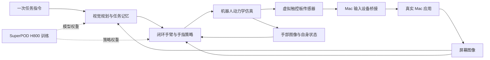

> Public export, 2026-10-30. Host/account identifiers and private evidence paths are removed. This is a design snapshot; current implementation and experiment status are maintained in STATUS.md and experiments/ledger.jsonl.

**机器人通过触控板使用 Mac：可行性与仿真方案**

> 后续修订：当前架构建议以同目录《docs/architecture.zh-CN.md》为准，实施交接见《docs/implementation-plan.zh-CN.md》。主候选改为完整可独立运动的四指手，二指机构作为简化对照；加入 MEM 风格多尺度记忆、ACT 风格短动作块与较新上层模型。下文二指优先/必须五指第二版等内容是早期草案，已被此次讨论取代；资源审计与原始来源证据仍可参考。

2026-10-30，Asia/Hong_Kong。已吸收最新范围调整：机器人应自由控制手指、根据屏幕持续修正并完成长程任务；SuperPOD H800 纳入实际算力方案；至少交付二指与完整五指两版，以二指为主线，禁用特定手指仅为整体训练跑通后的附加测试。资源复核截至本日 13:35 HKT；本次范围调整没有重新测量资源。

**结论**

这条路线具备搭建研究平台的条件，现有 RTX 与 H800 资源足够开展原型、策略训练和有边界的长程实验。目标定义为：给定一次任务指令，机器人仅依靠屏幕/场景图像和自身传感，连续决定手臂及手指动作，经虚拟触控板作用于真实 Mac，检查结果、处理失误，直到完成任务。

已核验的是资源、现有仿真入口、接触与 macOS 输入/图像接口的可用技术基础。新的触控板传感器、Mac 桥接、机器人策略和长程能力尚未实现或验收。不能把“接口能连接”当作“自主长程操作已经可行到任意应用”。

后端细化设计见同目录 `后端训练架构与数据设计_v1.md`：MuJoCo 作为训练与交互主物理后端，Isaac Sim 用于高质量视觉/接触复核；低层采用 BC → DAgger → recurrent PPO，上层采用预训练视觉语言模型及 LoRA 监督适配。模型、数据契约和参数以该设计说明为准，仍未开始实施训练。

**1. 目标与证据边界**

机器人运行时的动作应为手臂和手指的关节目标、速度或短动作片段；任务规划可以提出视觉目标，但不能绕过机器人向 Mac 发送目标坐标点击。Mac 收到的每一个动作必须有对应的仿真触点轨迹。正常控制可包含 PD、逆运动学或阻抗控制，它们负责把策略动作落实到动力学，不代替策略判断 GUI 是否操作成功。

“自由交互”的操作性定义：策略决定何时接触、滑动、抬指、重新落指、按压、使用哪些手指、是否重试；轨迹随视觉反馈改变。固定轨迹、预设完成顺序和人逐步指挥只能作为调试/对照，不计为最终自主结果。模型可以采用分层结构，无须从一开始把语言推理与毫秒级关节控制塞入一个网络。

两版是正式交付范围，二指优先完成完整的训练、Mac 闭环与长程任务，再推进五指版训练和对比：

| 版本 | 结构与能力范围 | 优先级 |
|---|---|---|
| 二指版 | 独立的简单二指机构，可由机械臂或 XY 平台承载；覆盖单指移动/点击/拖动，以及双指点击/滚动等常用交互 | 主线，先完成端到端长程任务 |
| 完整五指版 | 五根手指及其正常可控自由度全部开放，保留完整手部操作与更多多指交互的扩展能力 | 正式第二版，复用共同环境和任务体系并单独训练/验收 |

二指机构应按可落地的简单硬件单独建模。建议起点是共享平面运动、两指可分别落下/抬起，并带适当顺应性；指距可以先固定，需要捏合等相对指间运动时再增加对应自由度。普通只有开合运动的平行夹爪是否满足单指/双指接触切换，须依据其真实机构验证。完整五指的机械能力与 Mac 桥接已支持的手势分别列清单，不因五指模型存在就声称全部原生系统手势已实现。

两版共享触点协议、Mac 桥接、视觉任务和评估器，低层动作维度与控制器适配各自机构；不假定同一个低层检查点可以直接通用。主要对比长程任务成功率、时间、恢复能力、训练成本和硬件复杂度。禁用拇指/食指等测试放在两版训练与主要评估跑通之后，不作为主要研究目标、训练课程或完成门槛。

现有近邻证据：

| 研究 | 已有证据 | 与本任务的距离 |
|---|---|---|
| CUBot，2018，DOI 10.1142/S0218001418550054 | 外部视觉识别屏幕/光标，机械手操纵实体鼠标；论文描述与被操作电脑无直接数据通信 | 支持视觉—物理输入闭环，未证明 Mac 触控板或自由长程任务 |
| A Robotic Hand with Soft Transmission Systems for Automated Operations of Computer Mouse，2025，DOI 10.1002/aisy.202400966 | 软体鼠标手、UR5e、相机的闭环；本地正式全文明确讨论任务复杂度和预定义提示的限制 | 支持机械设计与闭环控制；不能作为通用电脑自主操作证据 |
| RoboTest，ICSE 2024，arXiv:2312.10655 | 视觉检测与四自由度机械臂执行触摸屏 GUI 测试 | 触摸屏绝对位置控制与触控板相对控制不同 |
| UI-TARS，arXiv:2501.12326 | 从截图进行 GUI 感知与多步决策的模型路线 | 可借鉴规划/记忆；其鼠标、键盘动作接口不能直接成为我们的机器人执行接口 |
| OSWorld / OSWorld 2.0，arXiv:2404.07972 / 2606.29537 | 真实电脑任务、跨应用与长程工作流评估 | 适合借鉴任务与结果验证；其软件交互成绩不等于机器人触控板成绩 |

本轮是定向可行性复核，不是穷尽式新颖性检索。已有文献足以支持“值得搭建验证”，不足以保证本题首次提出。主问题是简单二指机构如何通过视觉反馈可靠完成长程电脑任务，以及完整五指版本带来的能力与成本变化；指针增益变化和执行失误属于闭环鲁棒性评估。

**2. 实际资源与分工**

| 资源 | 证据与当前状态 | 分工 |
|---|---|---|
| Mac | 本机复核 Apple M5、16 GiB、macOS 26.4.1 | 真实应用、屏幕采集、输入设备桥接、实验观察 |
| RTX 工作站 | 当前复核 64 逻辑 CPU、约 251.5 GiB RAM、8×RTX 5880 Ada（每卡约 48 GB） | MuJoCo 交互仿真与部署策略；Isaac Sim/RTX 相机用于独立视觉复核 |
| RTX 工作站 环境 | `<SIMULATION_ENV>` 的包元数据：Isaac Sim 6.0.1.0、MuJoCo 3.8.0、PyTorch 2.11.0+cu128 | 复用既有版本；包存在不等于本任务训练/接触已验收 |
| SuperPOD | 官方规格 55 个 GPU 节点，每节点 8×H800 80 GB、约 2 TB RAM；实时 Slurm 验证每 GPU 节点 8 卡、224 线程 | 策略训练、模型微调、批量推理；后续验证无 RTX 依赖的并行物理环境 |
| SuperPOD 账户/队列 | 本轮按用户明确授权复用既有连接；当前 `SLURM_ACCOUNT` 关联 normal/preempt/cpu，GPU QoS 项目共享上限 96 GPU、最长 3 天、每用户 8 运行/10 排队加运行作业 | 初始申请单 H800 做环境和吞吐验收，再按实测扩到 4/8 卡；不能将共享上限当成专属分配 |
| Jetson AGX Orin | 历史已用作机器人侧计算；本轮未重新连接 | 后续真机视觉/策略部署，首版不依赖 |
| Windows 机器 | 历史有 12 代 i5 的记录，准确 GPU/RAM 尚未核实 | 不作为本方案成立的前提 |

RTX 工作站 在 13:28 HKT 的 2/4/7 号卡显存占用很低；这是瞬时快照，没有预留或停止任何任务。根卷可用约 479 GiB，按 df 口径已用约 96%，新实验要限额，重数据优先规划到 SuperPOD 项目/暂存空间。Kimi 本轮查询报告 project 约 5 TB 配额、约 4.9 TB 剩余，scratch 5 TB 几乎空；这是共享空间，也没有预留。重要结果不只保存在会清理的 scratch。

SuperPOD 连接与 Slurm 权限已核验；计算节点上的驱动、CUDA、PyTorch/MJX/容器兼容性尚未运行作业验证。H800 用于训练，不能当作 Isaac Sim RTX 渲染卡。NVIDIA 明确要求 Isaac Sim 使用具备 RT Cores 的 GPU。若在 H800 上扩展仿真，选 MuJoCo CPU/MJX 等不依赖 RTX 的路径并先实测，不能把 headless 理解成免除 Isaac 的硬件要求。

本机只检查了系统 Python 的包元数据，未穷举所有本地虚拟环境，因此不声称“Mac 上绝对没有任何 MuJoCo 安装”。

**3. Mac 在环的系统结构**

Mac 本身无需在仿真里重建。仿真包含桌面、触控板、机器人和必要的相机；真实 Mac 运行应用，输出图像，接收从触点推导的输入。

第一种观测模式直接传 Mac 截图，是理想化视觉输入，适合先检查 GUI 决策与接触控制。第二种把截图贴到仿真中的显示器表面，让机器人相机观察，加入透视、遮挡、分辨率和光照影响。两者分开报告，不能把清晰截图模式的结果直接视为真实摄像头验收。屏幕图像须包含光标；也保留手部/触控板视角和关节状态。

macOS 侧可用 ScreenCaptureKit 获取图像，用 Core Graphics 的鼠标、拖动、按钮及滚动事件形成最小输入链路。API 接受全局光标坐标时，由桥接内部从连续触点位移积分得到；策略不能调用这个坐标 API，桥接也不能接收目标按钮位置。辅助功能/屏幕录制权限属于首次运行的系统授权；本轮未触发权限提示或发送输入。

桥接软件在这里扮演虚拟输入设备。它不读取 DOM、辅助功能树、文件内容或应用内部状态来帮机器人决策。测试器可以独立读取最终文件/应用状态评分，但这些信息不得回流策略。

首版支持光标移动、单击、双击、拖动、合成滚动。普通 CGEvent 不应被描述为原生多点触控协议；双指滑动转成 scroll 只实现对应功能，不能据此声称已复现系统捏合、旋转、Mission Control、掌拒或 Force Touch。以后若要在目标 Mac 完全不装桥接，可考虑外置标准 USB HID 设备接收仿真输入，但普通鼠标 HID 同样不等于 Apple 触控板。

**4. 虚拟触控板必须保留的物理问题**

真实触控板检测电容变化；物理引擎主要给碰撞、接触位置、法向和冲量。因此先建立可校准的传感器替身，不声称做了完整电磁/固件仿真。真实硬件阶段还需验证导电/电容耦合指尖，裸塑料或金属接触并不自动等于能可靠触发真实触控板。

传感器输入包括每根指尖相对于板面的姿态、接触/近接状态、接触点簇、材质与可选力信息。输出为有稳定 identity 的触点序列：开始、移动、结束；同一根指尖的多个碰撞点要归并，避免被误认为多指。阈值、迟滞、漏检、噪声和指间分离可参数化并随机化。

触控板是相对定位：同一触点持续滑动产生光标增量；抬指时光标保留，重新落指不发生跳变。映射包含方向、增益和可能的速度依赖，而不是把板面坐标直接映射成屏幕绝对坐标。按压、轻触、点击保持和双指状态需要明确时序；接触力阈值只是首版的点击近似，不能称作 Apple Force Touch 标定。

核心日志链为：策略动作 → 实际关节/指尖轨迹 → 接触记录 → 触点记录 → Mac 事件 → 下一帧画面。每个事件记录来源序号、仿真步和时间。去重、抬指释放、断流释放按钮、迟到动作丢弃与焦点变化停发应属于设备层，防止长程实验积累错误状态。

Mac 在环时按真实时间推进；离线并行环境可以加速。物理步频、控制步频、图像帧率和大模型决策频率分开测量。首轮可从 120–240 Hz 物理、20–50 Hz 动作更新、15–30 Hz 图像开始测吞吐，这些都是配置起点，不是已达到的性能。不能把旧 WebRTC 视频帧率/RTT 当作新的动作到显示延迟。

**5. 支撑自由交互和长程任务的策略**

建议采用两层闭环：

- 任务层读取当前屏幕、任务要求和历史摘要，维护“已完成、待完成、当前假设、失败证据”，动态提出下一子目标，并从结果决定继续、回退或重试。可以借鉴截图 GUI 模型，但移除它直接控制系统鼠标/键盘的执行权限。
- 动作层读取屏幕/手部图像、关节位置速度与目标条件，输出手臂和手指关节动作。它持续修正运动，能自行抬指再定位、减速接近、维持拖动或恢复失误。触点真值供设备桥接使用；只有真实机器人预期配有相应触觉传感器时，才把对应带噪观测提供给策略。

初期先为二指机构用视觉伺服与控制器建立可解释基线，再用仿真示范、行为克隆和有界强化学习训练连续动作策略；二指整条链路跑通后复用基础设施训练完整五指版。两版主训练均正常开放各自手指，不设置特定手指禁用课程。分析脚本/教师可以使用目标真值采集示范或计算奖励；正式评估策略只看规定传感器。人正常使用 Mac 的屏幕与鼠标日志缺少手指/手臂关节信息，不能直接当成机械臂动作标注。

细化后以 MuJoCo CPU 物理与可重置 GUI 建立训练基线，H800 节点在同一作业中完成采样、批量策略推理和学习；吞吐不足时再验收 MuJoCo Warp/MJX。H800 同时承担离线 BC 和上层 LoRA，RTX 负责部署与高质量复核。BC 数据可以异步汇总，PPO 按当前策略版本同步收集一批新轨迹后更新；不能把跨机器旧轨迹直接当作 PPO 当前策略数据。H800 训练后端与图像生成路径仍需实际作业验收，Isaac 与 MuJoCo 的跨引擎差异另行评估。

真实 Mac 是串行、状态复杂且不易大量重置的环境，主要用于验证和有限的在线适配。不能让许多训练环境争用一个桌面。最终交互的快速动作环应留在 RTX/近端；SuperPOD 上的规划推理若要在线参与，需先验证队列生命周期、网络延迟与断线恢复。

**6. 分阶段实施及验收**

| 阶段 | 具体交付 | 通过标准的性质 |
|---|---|---|
| A：基础链路 | 独立桌面场景、简单二指机构、触点生成器、只记录事件的桥接；之后接入真实 Mac 测试窗口，单指动作仅作基础调试 | 离板不发移动、重新落指不跳光标、每次输入有真实接触来源、断流释放；仅证明链路 |
| B：二指自主闭环 | 屏幕与自身状态观测、二指机构动作策略；落指/滑动/抬指/点击/拖动/双指滚动 | 随机初始光标、增益、目标位置下修正动作；记录失误与重试；不能用目标坐标直接注入 |
| C：二指连续长程任务 | 一次自然语言指令、任务记忆、结果检查、自主恢复、完整轨迹 | 无人工逐步提示、无子任务间重置；完成多个有依赖的步骤和最终产物验证 |
| D：完整五指版与对比 | 五指全部正常开放，适配动作控制并完成训练；在共同任务集上对比两版，单独记录五指扩展功能 | 五指版也通过视觉闭环与长程验收；分别报告两版能力、训练成本和硬件复杂度 |
| E：后续附加测试 | 整体训练与主要评估跑通后，再考虑禁用拇指/食指等测试或人形平台迁移 | 不作为主线训练、交付完成或阶段 D 的前置条件 |

A 中的脚本轨迹只用于传感器和接口验收。C 验收优先的二指长程目标，D 完成正式五指版本；E 是可选后续扩展。未来使用人形平台时可先冻结腿与底盘，步行、双臂协同和全身平衡另行增加。完整五指版拟采用 MuJoCo Menagerie 的 Shadow Hand E3M5；本轮已解析其 24 个关节、20 个执行器。Allegro、LEAP 的所查模型为四指，不能替代五指交付。组合安装、关节限制与指尖碰撞仍需适配，不视作现成验收过的人形灵巧手系统。

推荐首个长程场景：在预先准备的本地图片集合中找出符合视觉条件的 5 张图片，逐张预览核对，使用菜单复制到已有目标文件夹，最后回到文件夹检查完整性。可先在可重置的资料工作台中训练，再在 Mac 的 Finder/Preview 中验收。任务以触控板可以完成的操作为主；自由文字输入先明确排除，扩展时应通过屏幕键盘或机器人操作实体键盘，不能后台粘贴绕过身体。

候选首轮评估规模：二指版先做 3 类任务，每类 20 次随机初始化；每次约 5–15 分钟、30–100 次语义交互目标，另外报告实际关节控制步数。五指版随后使用同一共同任务集及配对的初始条件，扩展手势另行评估。数值是待实施的实验设计，不是已有结果或成功承诺。布局、文件内容和增益要有未见测试划分。加入光标偏移、漏点、窗口移动及延迟等干扰，观察策略能否继续原任务。主评估不包含人为禁用指定手指。

指标包括完整任务成功率、子目标完成率、时间、非预期点击、滑动/抬指次数、误差恢复率、人工接管次数、接触违例、输入因果追踪覆盖率。最终产物用独立测试器验收；视频只帮助解释结果。软件 GUI 代理可作语义规划能力对照，机器人开环轨迹可作低层对照，都不混入本系统成功率。

有恢复机制的重要性可用一个简单例子理解：若每步独立成功率是 99%，连续 50 步全部成功只有约 61%。这个算例不是实验估计，但说明长程设计必须允许发现并修复错误。

**7. Kimi 分工、已完成工作与下一实施入口**

协调者负责目标、架构、证据边界、实验设计和独立验收。Kimi 负责有明确文件范围的实现、实际环境测试、失败修复和短报告；优先一个工人、同一明确会话续接，不假定它支持子代理。

本轮已经执行两次 Kimi 只读审计，并由协调者独立复核：

1. 本地/RTX 环境、包版本及接触/控制入口。
2. 按用户补充授权核查 SuperPOD。Kimi 的 association 查询遇到字段兼容错误，协调者去掉不兼容字段后，重新确认当前账户关联与 QoS。它不是待解决的权限障碍。

可复用的本地入口：`simulation_lab/home_search/run.py` 中 PhysX 接触订阅与图像采集；`simulation_lab/scripts/stream_isaac.py` 的 Franka 控制与网页串流。独立复查发现现有接触用途主要是碰撞记录，并没有触控板触点识别、相对光标映射或 Mac 输入桥接，需新建模块。

新的实验应使用独立目录、服务和端口，复用协议模式而不连接现有真实 NexArm 服务，不复用其硬件控制端点。当前根项目无首个 Git 提交；未来实现需另选干净开发基线/独立原型仓库，不能为通过 runner 检查把整个历史项目提交。

实施顺序与详细验收契约见同目录 `Kimi实施任务书.md`。第一项计算工作是单 H800、短时 Slurm 环境验收，之后才扩到训练；本轮没有提交作业，也没有启动仿真或对 Mac 发送输入。

历史只读资源审计已完成。原始会话、资源回执和账号配置保留在私有记录中，不随公开仓库分发。

**8. 主要来源与本轮检索限制**

- CUBot：[DOI](https://doi.org/10.1142/S0218001418550054)。本轮 Crossref 元数据 + 既有本地作者全文核对。
- 鼠标机器手：[DOI](https://doi.org/10.1002/aisy.202400966)。本轮 OpenAlex 书目 + 既有本地正式全文；Crossref 返回 429、Wiley 返回 403，因此未声称新下载全文。
- RoboTest：[arXiv](https://arxiv.org/abs/2312.10655)。本轮读取官方摘要页；既有全文用于背景。
- UI-TARS：[arXiv](https://arxiv.org/abs/2501.12326)；OSWorld：[arXiv](https://arxiv.org/abs/2404.07972)；OSWorld 2.0：[arXiv](https://arxiv.org/abs/2606.29537)。本轮核验记录/摘要，不声称复现其模型或结果。
- [Isaac Sim 6.0.1 接触传感器](https://docs.isaacsim.omniverse.nvidia.com/6.0.1/sensors/isaacsim_sensors_physics_contact.html)；[硬件要求](https://docs.isaacsim.omniverse.nvidia.com/6.0.1/installation/requirements.html)。方案按已安装版本固定，不直接套用 latest 示例。
- [MuJoCo 计算与接触模型](https://mujoco.readthedocs.io/en/stable/computation/index.html)；[MuJoCo Menagerie 模型库](https://github.com/google-deepmind/mujoco_menagerie)。模型目录存在不等于本任务适配完成。
- [Core Graphics 鼠标事件](https://developer.apple.com/documentation/coregraphics/cgevent/init(mouseeventsource:mousetype:mousecursorposition:mousebutton:))、[事件提交](https://developer.apple.com/documentation/coregraphics/cgevent/post(tap:))、[ScreenCaptureKit](https://developer.apple.com/documentation/screencapturekit/capturing-screen-content-in-macos)、[NSTouch](https://developer.apple.com/documentation/appkit/nstouch)。本轮读取 Apple 官方文档数据；NSTouch 是触点快照接口，不能据此推断可注入任意原生多指手势。
- [SuperPOD 官方硬件规格](https://itso.hkust.edu.hk/services/academic-teaching-support/high-performance-computing/superpod/hardware-specs)；[分区与资源政策](https://itso.hkust.edu.hk/services/academic-teaching-support/high-performance-computing/superpod/partition)。结合本日 SSH/Slurm 只读快照。

公开接口的成功/失败、抓取时间和本地文件路径见 `evidence/source_manifest.json`、`long_horizon_search.json`。学术 MCP 当前未挂载；改用公开 Crossref/arXiv/OpenAlex 与官方页面。检索脚本在系统 Python 3.9 因版本语法失败，因此使用标准库直接请求，不安装或改动运行环境。本次检索不产生完整领域覆盖保证。
