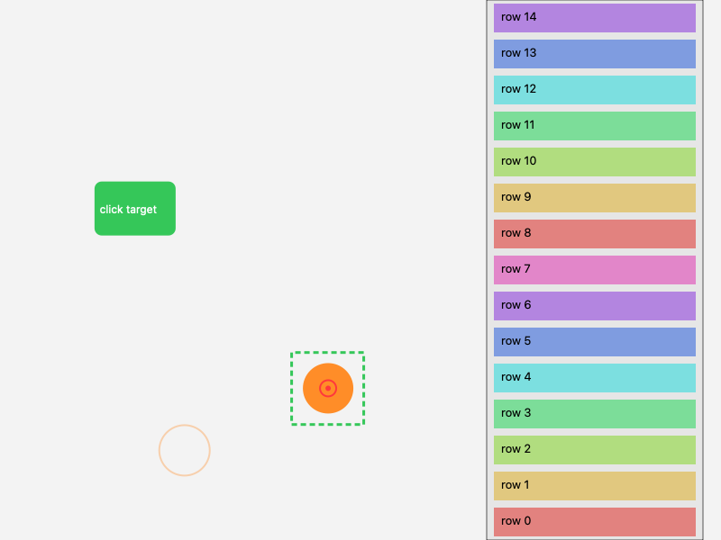

# TrackpadSandbox — bounded native Mac test GUI

Status: implemented and locally validated on the user's current M5 Mac
(macOS 26.4.1, arm64). This is an **original, purpose-built test GUI** — not
Finder, not whole-macOS, not a VM. No Finder/whole-macOS/VM acceptance is
claimed. Real-robot services are untouched. Work on a full macOS VM is a
separate task; this app is independent of it.

## Review history

- v0.1 (2026-10-30): first build, 110 tests + 10 smoke checks passed.
  **Not accepted**: coordinator independent review
  (`mac-independent-review.json`) reproduced 8 defects — held button survived
  0.8 s wall-clock silence, duplicate finger ids accepted, touch ack leaked
  cursor truth, omitted-then-returning finger jumped +24 px, `sequence=true`
  accepted as 1, x=0.09 accepted on a 0.16 m pad, drag completed when the
  press started outside the source, probes callable in normal mode.
- v0.2 (2026-10-30): all findings corrected; 43 protocol tests, 132-test
  full suite, 18-check smoke, diagnostics probes re-run. Coordinator
  confirmed actual object placement in smoke-3 PNG.
- v0.3 (2026-10-30): integration corrections — pad contract is 160 x 110 mm
  (half-height 0.055, was 0.115); sim-time expiry now applies BEFORE lift
  evaluation; click-target hits require the press origin inside the target;
  the privileged state query requires the launch-only `--evaluator` role;
  report timestamps are generated with `datetime.now(timezone.utc)` (the v0.2
  report's handwritten ts was future/wrong-zone; its exact execution UTC is
  unknown within the runner window and the original is preserved privately as
  superseded). 47 protocol tests, 136-test full suite, 18-check smoke.

## What it is

- Swift/AppKit app (`macos/TrackpadSandbox/`) rendering its own 800x600 task
  surface: visible virtual cursor, a click target, a draggable object with a
  destination, and a scrollable content strip. `reset(seed)` produces
  deterministic layouts (LCG).
- Ad-hoc code-signed with exactly one entitlement:
  `com.apple.security.app-sandbox=true`. No network, file-access, automation,
  or accessibility entitlements. IPC is inherited stdin/stdout JSONL only.

## Robot input wire (shared with the physics worker)

```json
{"cmd": "touch", "schema_version": "touch.v1", "sequence": 1,
 "simulation_time_s": 0.016,
 "contacts": [{"finger_id": "a", "x_m": 0.01, "y_m": -0.02, "normal_force_n": 0.4}]}
```

x/y are meters about pad center (+x right, +y up), bounded to **half** the pad
dimensions (|x| <= 0.08, |y| <= 0.055 on the default 0.16 x 0.11 m pad); an
omitted finger means lifted. The device model (`Sources/DeviceModel.swift`):

- relative cursor motion from per-finger deltas; first contact has no origin,
  so **first touch never teleports**; origins are rebuilt per frame, so a
  finger omitted from a frame loses its origin and a returning finger starts
  fresh (no jump);
- click/release from normal force with hysteresis (press >= 1.0 N,
  release <= 0.6 N, configurable);
- two-finger centroid scrolling; 3+ contacts track origins only;
- a finger-set/gesture-mode change (e.g. a second finger joining a held
  one-finger press) cancels the press **silently** — no fake click — and a
  full-hand frame cannot inherit a stale one-finger drag;
- strict numerics: JSON booleans are identified by CoreFoundation type ID and
  rejected for sequence/time/all real fields (NSNumber would otherwise bridge
  `true` to 1); non-finite values rejected;
- rejected messages (unknown fields, wrong schema, replayed/out-of-order
  sequence, non-monotonic time, >10 contacts, out-of-pad coordinates,
  >0.05 m per-sample deltas) consume no sequence and no state.

### Clocks and cancellation

Simulation timestamps and host wall time are strictly separate:

- sim-time inactivity > 0.5 s expires the gesture, evaluated BEFORE any
  gesture handling including a lift (a press followed by a long gap and empty
  contacts is cancelled silently: no release, no hit, no drag success);
- a **host monotonic watchdog** cancels any held button/drag after 0.8 s of
  wall-clock input silence (stalled transport) — no click is emitted;
- after any cancel, pressing stays suppressed until a fresh lift
  (empty-contact frame); `stop`/EOF clear all gesture state and never
  complete a task.

### Drag semantics

A drag arms **only** on a press down-transition whose cursor is inside the
draggable object; pressing elsewhere and sliding through the object never
arms it. While armed, the object is actually drawn at (and follows) the
cursor; its final position is retained on release. Completion is decided by
the object's observed placement inside the destination, not the cursor alone.
Releases and target hits are counted separately (`release_count` vs
`target_hits`). A click-target hit additionally requires the press's
down-transition to have started inside the target (down-outside then
slide-in-and-release is not an activation); the press origin is cleared on
release, cancel, stop, and reset.

## Channel separation

- `touch` acknowledgements carry **acceptance and sequence only** — never
  cursor, layout, or task-success truth.
- Actor observation (`capture`) is only PNG pixels of the app's own content
  view (never a host desktop capture), plus `frame_id`, `width`, `height`, a
  declared monotonic capture clock (`monotonic_time_s`), and the separate
  `simulation_time_s`.
- Evaluator state is a separate explicitly `privileged: true` `state`
  query, gated by the launch-only `--evaluator` role flag; a normal actor
  launch is rejected with `evaluator_required`. This is an enforced protocol
  role boundary, not an OS security claim.

## Client and CLI (`tools/mac_sandbox_client.py`, stdlib only)

All reads are bounded (select-based deadlines: startup, mid-session, and
partial-output hangs all raise instead of blocking); teardown always reaps
the child process. The normal client exposes only the contact/capture
lifecycle plus the privileged state query.

- `smoke` — bounded synthetic smoke (18 checks: move/click/drag/scroll,
  negatives, watchdog, stop/EOF). **Synthetic smoke input is ineligible for
  training.** Gestures stay inside pad bounds via lift/reposition hops.
- `hold` — launches the app and keeps the window visible for coordinator
  inspection (Ctrl+C closes only this app).
- `probe` — diagnostics-only launch (`--diagnostics --canary-root <dir>`):
  writes only the fixed name `sandbox-canary.txt` under the designated fresh
  root, and connects only to a validated loopback port (1..65535). Probe
  commands are rejected in normal mode.

## Entitlements vs. measured restrictions (this host)

Declared: only `com.apple.security.app-sandbox=true` (ad-hoc signature,
`codesign --verify --deep --strict` PASS). Measured:

- writing the designated canary file outside the container: **denied**
  (NSCocoaErrorDomain 513);
- localhost TCP connect (ports 9 and 65000): **denied** (EPERM errno 1);
- probes in normal (non-diagnostics) mode: rejected `diagnostics_disabled`;
- stdin/stdout JSONL: permitted (inherited channels).

## Build, test, evidence

- Build+sign: `bash macos/TrackpadSandbox/build.sh` (output in ignored
  `.local/build/`). Exact command receipts: `.local/qa-receipt.txt`.
- `tests/test_mac_sandbox_protocol.py` — 47 real-app tests covering every
  review finding (watchdog cancel/suppression, returning-finger no-jump,
  duplicate/empty ids, boolean and half-extent rejection, drag arming
  negative/positive with object placement, ack minimization, capture shape,
  bounded reads, zombie reaping, diagnostics gating).
- Full suite: 136 passed. Smoke: 18/18 with pixel-difference PNGs and hashes
  recorded in `experiments/records/mac-sandbox-first.json`.
- Linux CI (Ubuntu) does not exercise the native app: this test module skips
  at collection on non-darwin platforms; the real-app tests are mandatory on
  macOS and are never mocked.
- Reports: `.local/progress.json`, `.local/final-report.json`.

## Known limits

- Synthetic contacts only; no physical touchpad hardware in the loop. These
  are software/protocol semantics tests, not physical robot evidence. Does
  not implement or imply Apple native multitouch.
- Capture renders only the app's own view; no desktop capture exists.
- Click semantics are force-hysteresis only; no separate tap gesture.

## Reviewed image

This saved image comes from the corrected synthetic-contact smoke test. It shows the orange object retained inside its destination after a valid drag. It is a software test result, not a live robot stream.


