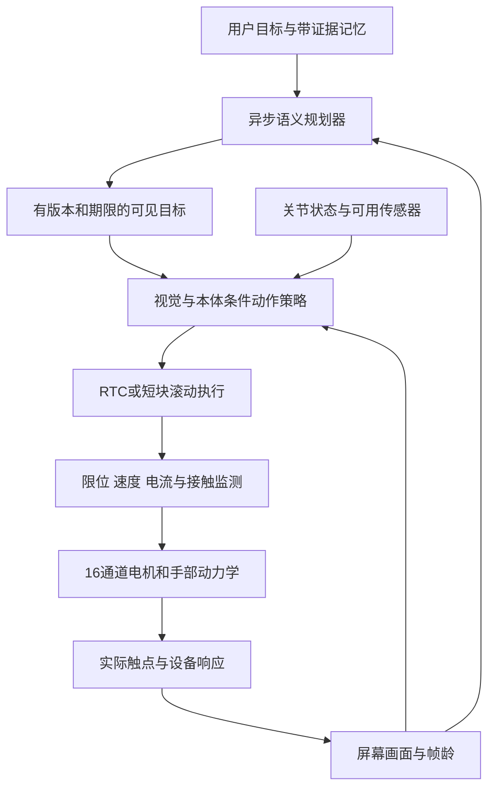

# LEAP v1 Full：分层架构与三种 VLA 的取舍

2026-10-31。硬件按用户最终选择改为 **LEAP v1 Full：四指、16 个主动关节，16×XC330-M288-T**。本页是设计评审，不是模型迁移、传感器安装或训练结果。细节配套：[π0.5 微调报告评审](2026-10-31-pi05-finetuning-review.zh-CN.md)、[FSR 设计](../hardware/leap-v1-fsr.zh-CN.md)、[决策](../decisions/0007-leap-v1-full-and-learning-priorities.zh-CN.md)。

## 保留分层，但明确三种频率

System 1/System 2 是有用的逻辑分工；不能据此把整套系统划成“VLM 5 Hz、神经网络 100 Hz”两个固定数字。初步实现应分开：语义规划、动作策略、确定性的电机执行与监测。

| 环节 | 初始设计范围，须测量后冻结 | 触发与边界 |
|---|---|---|
| 语义规划与记忆 | 事件驱动，稳定阶段可约 0.5–2 Hz 或更低 | 新目标、布局明显变化、失败/不确定、目标到期；不必每帧推理 |
| 屏幕观测与轻量跟踪 | 初步 30 Hz，必要时评估 60 Hz | 同时保留全局画面与局部裁剪，丢光标时全图重找 |
| 学得动作策略 | 依实测模型约数 Hz 至数十 Hz | 不把策略调用频率和输出轨迹频率混淆；测端到端 p50/p95/p99 |
| 轨迹执行/本体监测 | 50–100 Hz 为初始目标 | 本地有界插值、限位、阶段和陈旧指令检查；Linux/Python/USB 默认不构成硬实时保证 |

π0.5 报告中的 140 ms 推理与 50 Hz 命令并不矛盾：使用时间标记的动作队列和 RTC。队列能缓解延迟，但不会凭空产生未观察到的接触信息。贴面时需要较保守速度、及时释放和局部反馈；若实测表明 VLA 反应不够，才引入有界快速视觉残差或蒸馏小策略。

手指有 16 个电机，不代表每个电机 100 Hz 独立完整通讯没有开销。XC330 支持 4 Mbps、同步读写和当前电流，但 USB 延迟、半双工返回、Return Delay、解码、相机和线程调度都计入周期。只测 Flow ODE kernel 的时间不等于完整物理闭环时延。

## 对提供方案的逐项判断

| 主张 | 判断与修订 |
|---|---|
| 所有 GUI 必须百亿 VLM | 不成立；先测轻量 Qwen3-VL 等的定位/结果核验，再按任务增加规模。复杂长期任务可受益于大模型，但“需要多少参数”是实证问题 |
| Orin 上 80M、5 步 Flow 固定 6–8 ms | 未找到本配置实测依据。视觉编码、分辨率、chunk、精度、缓存、功耗和 I/O 均影响延迟 |
| 单大模型输出关节必然震荡 | 过度推断。延迟、增益、执行器、感知和执行方式共同决定；RTC 的实际报告已表明低频模型可持续执行高频轨迹 |
| H=16 必然代表 0.16 s | 只有动作时间间隔为 0.01 s 才成立；50 Hz 是 0.32 s，20 Hz 是 0.8 s |
| 同时学习 Δq 和 I_limit | 首版只学 16 维位置参考或明确定义的增量；电流上限由独立配置固定。不要让策略提高自己的限制，也不要在线高频写 EEPROM Current Limit |
| 电流直接等于指尖压力 | 不成立；电流还包含惯性、重力、摩擦、传动与姿态效应。FSR 可增加局部观测，但仍需标定 |
| 只看光标 crop | 会失去目标、界面改变和重定位信息；需要全图/目标 crop/光标 crop 及其坐标变换和置信度 |
| 裸 z_goal 可连接任意两模型 | 未经联合训练或适配的隐向量不可直接互换。先用结构化可审计意图，再由低层编码器转为条件特征 |
| 现在切换 Isaac Lab、8192 环境几小时出策略 | 无本任务依据；优先复用已有 MuJoCo/MJWarp 管线，v1 仍须重验。只在出现明确功能/性能缺口时对比 Isaac Lab |
| MediaPipe/HaMeR＋重定向等于可用示范 | 可作低成本入口；遮挡、深度尺度、抖动、手指差异及力标签缺失需要校准和实际执行验证。不可把空气手势当作关节接触真值 |
| Flow Matching 必然优于 MLP、彻底消除多模态冲突 | 过度推断；历史、网络架构、生成分布和动作块长度是不同因素。MLP 可输出整块，ACT/CVAE 也可表达多模态；每步重采样仍可能切换策略模式 |
| CGEventTap 给出所有手势的 100% 真值 | 光标/按钮/滚动可有可用事件通路，但 AppKit 的 pressure stage 和 magnify 是特定事件语义；不是所有 app 的全局完整真值。缩放事件增量也不等于目标 app 的最终缩放结果 |
| 通宵 4–6 小时后达到人类水平 | 没有证据。以 100 Hz 算是 144–216 万控制 tick，以 20 Hz 算是 28.8–43.2 万；独立 episode 和有效探索远少于 tick，次数不能保证学习成功 |

## π0.5、GR00T N1.7、LingBot-VLA 2.0

| 方案 | 值得借鉴或实测 | 当前可省去的部分/限制 |
|---|---|---|
| **π0.5** | 机器人预训练权重；高层文字子任务与连续动作；全量微调对照；RTC。Dream Machines 提供了有分母的实机经验，因此列为首个主要 VLA 候选 | 不从零复建其大规模多源预训练。公开 OpenPI 当前只支持 π0.5 的 flow head 训练/推理，不能默认论文完整高层联训都开箱可用；没有本项目 GUI/LEAP 成绩 |
| **GR00T N1.7** | Cosmos-Reason2-2B/Qwen3-VL 底座＋Flow Matching DiT；新本体适配、归一化/掩码、训练部署接口、TensorRT；作为后续相同数据的竞争基线 | G1 全身控制、腿/腰/头、移动基座和人形预训练接口并非桌面手任务必要项；相对 EEF 表征不自动解决 16 个手指关节。现有预训练目标和视觉域仍需适配 |
| **LingBot-VLA 2.0** | 数据对齐与质量检查；当前/未来特征预测的辅助任务；动作语义和有效 mask；为研究预测接触/光标变化提供思路 | 默认 55 维里只有 12 维 hand joints，不能无损容纳本项目 16 独立关节。需要明确新映射/扩展与重新适配；6B MoE、Depth/DINO-Video 双教师和多本体预训练对当前单手不宜全部复刻 |
| **小型 CNN/GRU 或 ACT** | 可诊断、可测时延的工程与数据效率基线；验证截图因果作用及最小可用数据 | 不承诺从零训练少量轨迹就达到 VLA 泛化；若后续蒸馏，报告教师质量和额外数据成本 |

N1.7 官方部署表中，LIBERO checkpoint、两张 256×256 图、40 步动作块、4 次去噪、batch1 的完整策略调用，Orin MAXN＋TensorRT 中位数为 **149 ms**，不含 RPC；这是其特定 32-block checkpoint 的测量，不是我们 80M 网络的下界或本机成绩。README 的新默认 action head 为 16 层，不应混为同一基准。部署支持 Orin，也不意味着本项目现有 Jetson 软件栈已兼容；本轮没有升级或连接设备。

LingBot 2.0 官方报告包含约 60,000 小时多源预训练；这种 MoE/多本体成本与我们首批数百轨迹不是同一问题。未来特征预测也不等于 15 分钟任务记忆。长期状态仍须保存已观察事实、待办、失败、证据帧和版本，独立测试历史信息依赖。

## 资源分工

- 本地 Mac/近端控制端：受限 GUI、采集和时间戳；硬件到位后本地执行器通讯、FSR/本体采样与监测。现有 Jetson/机器人服务不因设计讨论被占用。
- 组内 RTX5880：先用一张卡评估候选推理，另按需要做小规模微调；不足再量测多卡。无需预先把六张卡永久划给一个手的 RL learner，单手的数据产生和评估往往先成为瓶颈。
- H800：有界批量仿真、离线训练、较大微调比较；不让本地接触控制依赖调度系统和外部网络的逐周期往返。新个人账户的访问、环境和配额在本地记录中仍待验收；历史分配不是当前可用性证明。

千兆 LAN 的链路延迟不等于完整观测延迟。1920×1080 RGB、30 Hz 原始像素约 1.49 Gbit/s，已经超过 1 Gbit/s 的名义链路；需裁剪/压缩、流水线和帧龄监测。权重不能在任意分钟中途热换：候选版本经独立评估，回合边界原子切换，记录版本与回滚点。

## RL 与奖励的准确位置

用户已明确：**RL 保留为中后期补充，依届时实际效果决定是否启动。** 模仿学习、纠错和执行调度达到约定的任务标准，就可以不增加 RL；如果仍有接触稳定性、离合效率、误触恢复或长程成功率瓶颈，就针对残余问题继续引入 RL。其触发不应只看训练 loss，也不是到了某个日期自动进入“通宵训练”。

届时先用失败回放区分感知、标定、执行延迟、数据覆盖和策略决策问题，冻结相同任务与布局下的非 RL 基线。RL 实验记录新增交互量、人工干预、奖励误判、独立测试成功率及压力/误触等约束；在相同评估条件下确认有收益再替换策略。这个条件路线不是当前已有 RL 实现或已开始运行。

仿真中的特权 PPO 可作为接触、离合和两指控制教师，但训练 actor 的输入需考虑可部署传感器；若教师用了全状态，就再蒸馏或设置 actor/critic 不对称，而非直接部署其特权输入。先保持 MuJoCo CPU 正确性参考，扩大 batch 前记录接触、随机化与图像开销。

RECAP 是 **Experience & Corrections via Advantage-conditioned Policies**：价值/优势估计、正/负优势条件、示范＋纠正＋自主经验。不能直接称为 Advantage-Weighted Flow Matching；AWR 是另一种用优势权重调监督损失的方法。RLPD 提供先验数据混合、critic 正则化等经验，其原始 off-policy actor/critic 不会自动适配任意 flow chunk policy。策略概率、动作执行跨度、折扣和时间集成需明确。

奖励先基于可审计的受限 GUI 结果：确认目标激活、完成拖放或内容缩放；距离变化、耗时和动作平滑可作辅助。只有距离惩罚可能学成停在目标附近，只有电流惩罚不能保证指尖压力，只有动作变化惩罚可能抑制必要重定位。不同单位项应归一化并做消融；不可依靠惩罚项替代独立运动约束。

自动 GUI reset 不等于物理 reset：手指姿态、残留按压、传感器偏置、温升和安装漂移仍需检查。先短程有监督回合、再有限自动回合，最后才评估无人值守训练。外置摄像头有利于最终无软件辅助部署，但会引入反光、摩尔纹、透视和遮挡；初期使用受限窗口截图可减少变量，两个观测域应分开验收。

## 来源

本轮[来源清单与固定版本](../../experiments/records/vla-review-sources-20261031.json)记录检索时间、内容 SHA256、四个核验过的代码文件版本与未成功请求。

- [LEAP v1 Full/Lite BOM](https://v1.leaphand.com/parts)、[XC330-M288-T](https://emanual.robotis.com/docs/en/dxl/x/xc330-m288/)。
- [π0.5](https://www.pi.website/blog/pi05)、[OpenPI](https://github.com/Physical-Intelligence/openpi)、[Knowledge Insulation](https://www.pi.website/research/knowledge_insulation)、[RTC](https://www.pi.website/research/real_time_chunking)。
- [GR00T N1.7](https://github.com/NVIDIA/Isaac-GR00T)、[部署与基准](https://github.com/NVIDIA/Isaac-GR00T/blob/main/scripts/deployment/README.md)。
- [LingBot-VLA 2.0 官方实现](https://github.com/Robbyant/lingbot-vla-v2)、[技术报告](https://arxiv.org/html/2607.06403v1)。
- [RECAP](https://www.pi.website/blog/pistar06)、[RLPD](https://arxiv.org/html/2302.02948v3)。
- Apple [stage](https://developer.apple.com/documentation/appkit/nsevent/stage)、[magnification](https://developer.apple.com/documentation/appkit/nsevent/magnification)；同时只读核对了本机 SDK 的 NSEvent/CGEventTypes 声明，没有安装或监听事件。
