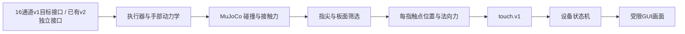

# 当前仿真如何识别触控

核对日期：2026-10-31。本文说明已有 **LEAP v2 CPU 接触适配器与原生受限 GUI** 的实际代码；v1 Full 的独立手部运动基线已运行，板面接触仍待接入，不能把 v2 触控结果改称 v1。尚无训练或视觉反馈闭环验收。

核心依据是 **MuJoCo 物理接触求解结果**，不是指尖 FSR、视觉分类器或真实触控板的电容信号。当前简化假设是：合格的指尖接触可以被虚拟设备识别。

## 从碰撞到触点

已有适配器在每个物理采样时刻读取 `MjData.contact`，并通过 `mj_contactForce` 获取每个接触的六维力/力矩。它保存碰撞双方、世界坐标、接触坐标系、距离与原始力，不只检查“指尖高度小于某值”。

成为可用触点需要满足：

1. 接触的一方是静止触控板，另一方属于已登记的末端指节碰撞体。
2. 接触方向指向板面上方；当前顶面筛选是接触法线与板面朝上轴点积至少 0.99。侧边、背面、非末端指节碰板和手部自碰撞另外记录，不转换为合格触点。
3. 法向力是有限正数。负力不取绝对值，NaN/无穷值必须在聚合之前拒绝。

同一手指可能产生多个求解器接触点。将它们合并成一个触点：法向力求和，位置按法向力加权平均，并转换到触控板局部坐标。这样一个指腹不会因为碰撞网格产生多个“手指”。

输出字段是 `finger_id`、`x_m`、`y_m`、`normal_force_n`；帧同时携带序号和仿真时间。已有记录器至少每 0.05 秒保存一次触点帧，并额外保留触点集合变化与空触点释放帧。这是当前离线记录流的采样规则，不代表已部署 100 Hz 在线控制。

代码：[接触提取与聚合](../src/embodied_trackpad/leap_sim/pad_env.py)。其中 `0.05 N 持续至少 0.3 s` 是持续接触诊断的验收条件；**当前触点生成使用的是正法向力条件，并非这个诊断阈值**。

## 从触点到光标和按钮

原生 GUI 的 [DeviceModel.swift](../macos/TrackpadSandbox/Sources/DeviceModel.swift) 只接受板面坐标和载荷，不接受目标按钮坐标。当前设备模型为：

| 输入状态 | 当前行为 |
|---|---|
| 单指首次落板 | 建立运动起点，光标不跳到指尖的绝对位置 |
| 同一手指持续滑动 | 用相邻帧位移乘固定增益移动光标；默认 4000 像素/米，即 1 mm 对应 4 个逻辑像素 |
| 单指法向力达到 1 N | 进入按钮按下状态 |
| 已按下后力降至 0.6 N 或正常抬起 | 释放按钮；是否完成目标由 GUI 的任务逻辑另判 |
| 两指持续接触 | 两触点质心的纵向变化产生滚动，不产生单指按压 |
| 三指及以上 | 只更新接触起点，当前没有对应手势 |
| 触点超出板面、重复手指、非有限数或异常大跳变 | 拒绝这一帧 |
| 传输停滞/超时或手势模式异常切换 | 取消手势；不能把异常退出伪造成一次成功点击 |

抬指会清除该手指的运动起点，重新落板时再建立起点，允许离合/接力移动。1 N 与 0.6 N 之间的滞回减少按钮状态来回抖动；它们都是软件配置，**不是已测得的 Apple Force Touch 参数**。当前固定线性增益也未复现 macOS 的非线性加速度。

**当前未实现双指缩放、旋转、三指横滑和完整 Apple 手势状态机。** 后续应分别建立并验收这些设备行为；不能仅凭触点消息能带多个手指就宣称已支持对应手势。

## 对当前训练阶段的含义

FSR 与导电指腹可以按用户要求后置；模拟器本身能产生接触真值，供虚拟设备运作和教师/评估器使用。正常策略仍按视觉和可部署本体状态设计，不能直接读取 GUI 光标坐标，也不能在没有力传感器的配置中读取理想接触力冒充真实观测。

首轮使用已声明的理想化触控识别，先验证动作、反馈与训练管线。设备识别阈值、延迟、漏检和摩擦变化以后可成为独立实验参数；在没有硬件测量时，只能称为设计的扰动范围。当前 v2 的离线触点回放已验证图像变化，但图像尚未反过来影响后续电机动作。
